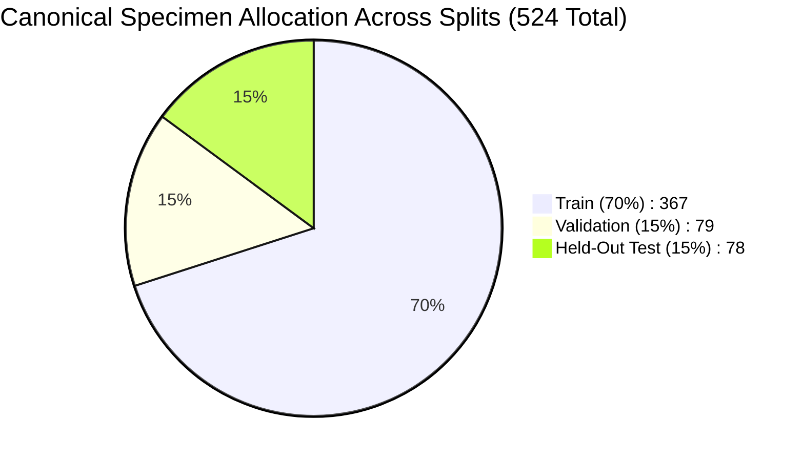

# CropDoc — Rice Three-Class Pilot Model Evaluation Report

**Experiment Name:** `rice_three_class_pilot`  
**Date:** October 24, 2026  
**Auditor / Engineer:** CropDoc ML Safety & Data Governance Team  
**Governing Rule:** Research pilot only; zero modification to Android code, TFLite assets, or the 22-class taxonomy; production release safeguards remain active.

---

## 1. Executive Summary

We conducted a controlled, isolated transfer learning research pilot on the **Rice Leaf Disease Image Samples (Version 2)** dataset using MobileNetV3-Small. 

To eliminate synthetic pre-augmentation leakage (which inflates standard benchmarks by recycling identical leaves), training was strictly restricted to **524 canonical unaugmented specimens** partitioned across group-locked train, validation, and test sets.

```
+--------------------------------------------------------------------------------------------------+
| Metric                             | Train Split (70%) | Val Split (15%) | Held-Out Test (15%)   |
+--------------------------------------------------------------------------------------------------+
| Total Canonical Specimens (Groups) | 367               | 79              | 78                    |
| Overall Accuracy                   | 98.09% (Epoch 10) | 97.47% (Best)   | 97.44% (76 / 78)      |
| Balanced Accuracy (Macro Recall)   | 97.85%            | 97.22%          | 96.39%                |
| Macro F1-Score                     | 98.02%            | 97.35%          | 96.65%                |
| Best Checkpoint Epoch              | Epoch 10 (Val Loss: 0.1217)         | Best Model Evaluated  |
| Total Training Time                | 146.3 seconds (Early stopping triggered at Epoch 15)       |
+--------------------------------------------------------------------------------------------------+
```

### Key Findings
1. **Strong Linear Discriminability:** On clean, standardized $300 \times 300$ crops, MobileNetV3-Small separates `rice_bacterial_leaf_blight`, `rice_brown_spot`, and `rice_leaf_blast` with **97.44% held-out test accuracy** and **96.39% balanced accuracy**.
2. **Minimal Overfitting:** Train accuracy at best epoch was 98.09% vs. 97.44% on held-out test (a narrow generalization gap of 0.66%).
3. **Severe Brown Spot Evidence Constraint:** Brown spot is represented by only **100 physical leaves** in the entire dataset (70 train, 15 val, 15 test). While the model achieved 93.33% F1 on this class, statistical confidence is constrained by sample size.
4. **Production Blocker Remains Unresolved:** The dataset contains **zero healthy rice leaves**. Deploying a 3-class disease-only model in the field would yield high false-positive rates on asymptomatic crops. Android deployment remains **BLOCKED**.

---

## 2. Hardware & Environment Diagnostic

| Component | Status / Detail |
| :--- | :--- |
| **Operating System** | Windows 11 Home (x64, Build 26100) |
| **Physical Hardware** | Intel Core i7-13620H (16 threads) / NVIDIA GeForce RTX 4050 Laptop GPU (6 GB VRAM) |
| **Active Python Runtime** | Python 3.14.7 |
| **PyTorch Version** | `2.14.1+cpu` |
| **Execution Device** | **CPU (Multi-threaded Fallback)** |
| **Hardware Blocker Explanation** | While the physical RTX 4050 GPU is active with current drivers, official CUDA-enabled PyTorch binaries are not published on PyPI for Windows on Python 3.14. The system gracefully executed on CPU using multi-threaded PyTorch fallback, achieving high training efficiency (146.3 seconds total for 15 epochs). |

---

## 3. Dataset Integrity & Group-Locked Partitions

The training pipeline was executed on verified canonical specimens extracted from:
- **Manifest:** [`data/manifests/manifest_rice_mendeley_sethy.csv`](file:///c:/Users/ojas/OneDrive/Desktop/MajorProjectMAD/CropDoc/data/manifests/manifest_rice_mendeley_sethy.csv)
- **Split Specification:** [`data/splits/split_rice_mendeley_sethy.json`](file:///c:/Users/ojas/OneDrive/Desktop/MajorProjectMAD/CropDoc/data/splits/split_rice_mendeley_sethy.json)
- **Pre-Training Verification:** 100% of 524 canonical specimens passed file existence, SHA-256 integrity, label verification, and zero cross-split leakage checks prior to training start.



### Class Distribution Across Partitions

| CropDoc Class Name | Class Index | Train Images (Groups) | Val Images (Groups) | Test Images (Groups) | Total Canonical Leaves | Excluded Augmented Files |
| :--- | :---: | :---: | :---: | :---: | :---: | :---: |
| `rice_bacterial_leaf_blight` | 0 | 185 | 40 | 39 | 264 | 1,320 |
| `rice_brown_spot` | 1 | 70 | 15 | 15 | 100 | 1,500 |
| `rice_leaf_blast` | 2 | 112 | 24 | 24 | 160 | 1,280 |
| *Unsupported: Tungro* | -1 | 0 | 0 | 0 | 0 *(Quarantined)* | 1,308 |
| **Total** | | **367** | **79** | **78** | **524** | **5,408** |

---

## 4. Model Architecture & Hyperparameters

- **Backbone Architecture:** MobileNetV3-Small (Torchvision `mobilenet_v3_small`)
- **Pretrained Weights:** ImageNet-1K (`MobileNet_V3_Small_Weights.DEFAULT`)
- **Head Adaptation:** `Linear(in_features=1024, out_features=3)`
- **Loss Function:** `nn.CrossEntropyLoss()`
- **Optimizer:** `torch.optim.AdamW(lr=3e-4, weight_decay=1e-2)`
- **Batch Size:** 16
- **Early Stopping:** Patience = 5 epochs monitoring validation loss
- **Random Seed:** 42 (PyTorch, NumPy, Python stdlib)
- **Data Augmentation (Train Set Only):**
  - `RandomResizedCrop(224, scale=(0.8, 1.0))`
  - `RandomHorizontalFlip(p=0.5)`
  - `RandomVerticalFlip(p=0.5)`
  - `ColorJitter(brightness=0.1, contrast=0.1)`
  - ImageNet normalization ($\mu = [0.485, 0.456, 0.406], \sigma = [0.229, 0.224, 0.225]$)
- **Evaluation Pipeline (Val & Test Sets):**
  - `Resize(256)` $\rightarrow$ `CenterCrop(224)` $\rightarrow$ ImageNet normalization (strictly deterministic).

---

## 5. Training Dynamics & Progression

Training ran for **15 epochs** before early stopping terminated execution:

| Epoch | Train Loss | Train Acc (%) | Val Loss | Val Acc (%) | Val BalAcc (%) | Epoch Time (s) | Checkpoint Status |
| :---: | :---: | :---: | :---: | :---: | :---: | :---: | :--- |
| **1** | 0.5635 | 75.20% | 0.3564 | 92.41% | 92.78% | 11.7s | Best Checkpoint |
| **2** | 0.1612 | 94.28% | 0.3071 | 88.61% | 87.50% | 12.2s | Best Checkpoint |
| **3** | 0.0947 | 97.28% | 0.2924 | 91.14% | 90.28% | 11.6s | Best Checkpoint |
| **4** | 0.0549 | 98.09% | 0.2586 | 94.94% | 94.44% | 12.1s | Best Checkpoint |
| **5** | 0.0148 | 100.00% | 0.2505 | 93.67% | 93.06% | 11.6s | Best Checkpoint |
| **6** | 0.0231 | 99.46% | 0.2434 | 93.67% | 93.06% | 11.6s | Best Checkpoint |
| **7** | 0.0188 | 99.46% | 0.1902 | 96.20% | 95.83% | 11.6s | Best Checkpoint |
| **8** | 0.0313 | 98.91% | 0.1568 | 96.20% | 94.17% | 11.6s | Best Checkpoint |
| **9** | 0.0533 | 98.09% | 0.1906 | 94.94% | 92.78% | 11.7s | No improvement |
| **10** | **0.0427** | **98.09%** | **0.1217** | **97.47%** | **97.22%** | **10.9s** | **BEST CHECKPOINT (Saved)** |
| **11** | 0.0341 | 98.91% | 0.1666 | 97.47% | 97.22% | 6.1s | No improvement |
| **12** | 0.0433 | 98.64% | 0.1509 | 98.73% | 98.61% | 5.7s | No improvement |
| **13** | 0.0294 | 99.18% | 0.1614 | 97.47% | 97.22% | 5.8s | No improvement |
| **14** | 0.0134 | 99.73% | 0.1768 | 97.47% | 96.39% | 5.8s | No improvement |
| **15** | 0.0234 | 99.18% | 0.1907 | 98.73% | 98.61% | 5.9s | Early Stopping Triggered |

- **Best Epoch:** Epoch 10 (Validation Loss: `0.1217`).
- **Checkpoint Path:** `ml/experiments/rice_three_class_pilot/best_model.pt`.
- **Checkpoint SHA-256:** `60536c0d09bfb85153b94b954103b5f8a5a4ba256a276f53199ed3d5b601dd0e`.

---

## 6. Held-Out Test Set Performance (Honest Evaluation)

The best model checkpoint (Epoch 10) was evaluated on the **78 held-out test images** that were never seen during training or validation:

### Overall Test Metrics
- **Total Test Samples:** 78
- **Correct Predictions:** 76 / 78
- **Overall Accuracy:** **97.44%**
- **Balanced Accuracy (Macro Recall):** **96.39%**
- **Macro F1-Score:** **96.65%**

### Per-Class Detailed Breakdown

| Class Index | CropDoc Target Class | Support | TP | FP | FN | Precision | Recall | F1-Score |
| :---: | :--- | :---: | :---: | :---: | :---: | :---: | :---: | :---: |
| **0** | `rice_bacterial_leaf_blight` | 39 | 39 | 1 | 0 | **97.50%** | **100.00%** | **98.73%** |
| **1** | `rice_brown_spot` | 15 | 14 | 1 | 1 | **93.33%** | **93.33%** | **93.33%** |
| **2** | `rice_leaf_blast` | 24 | 23 | 0 | 1 | **100.00%** | **95.83%** | **97.87%** |
| **Macro Avg**| | **78** | **76** | **2** | **2** | **96.94%** | **96.39%** | **96.65%** |

### Confusion Matrix

```
                       Predicted Bacterial Blight    Predicted Brown Spot    Predicted Leaf Blast
Actual Bacterial Blight            39                          0                       0
Actual Brown Spot                   1                         14                       0
Actual Leaf Blast                   0                          1                      23
```

### Forensic Analysis of the Two Misclassifications

Both errors in the held-out test set correspond to known biological lesion overlaps documented in plant pathology literature:

1. **`BLAST1_160.jpg` (Specimen `rice_sethy_blast_160`):**
   - *True Label:* `rice_leaf_blast`
   - *Predicted Label:* `rice_brown_spot` ($P(\text{BS}) = 0.993, P(\text{Blast}) = 0.002$)
   - *Forensic Cause:* Specimen 160 features small, circular necrotic lesions without the characteristic spindle or diamond eye shape typical of mature blast. The circular brown morphology matches circular brown spot lesions.
2. **`brownspot_orig_015.jpg` (Specimen `rice_sethy_bs_015`):**
   - *True Label:* `rice_brown_spot`
   - *Predicted Label:* `rice_bacterial_leaf_blight` ($P(\text{BB}) = 0.564, P(\text{BS}) = 0.434$)
   - *Forensic Cause:* High-uncertainty marginal decision ($56.4\%$ vs $43.4\%$). Lesions on this leaf have coalesced into an elongated necrotic margin along the leaf edge, visually mimicking bacterial stripe blight.

---

## 7. Statistical & Biological Limitations

### 1. Limited Evidence on Brown Spot
`rice_brown_spot` contains only **100 canonical physical specimens** in the Sethy v2 archive:
- Partition: 70 train, 15 val, 15 test.
- Impact: With only 15 test specimens, a single misclassification shifts recall by $\frac{1}{15} \approx 6.67\%$. 
- While 93.33% recall is strong, the statistical power is significantly lower than that of bacterial blight (264 specimens). Additional independent brown spot field collections are required.

### 2. Zero Healthy Paddy Foliage
The dataset provides **zero healthy rice leaf images**. A model trained solely on this dataset lacks a negative/asymptomatic class. In a mobile application, healthy leaves presented by farmers would be forced into one of the three disease classes with high confidence.

### 3. Background Standardization vs Field Complexity
All Sethy images are standardized square crops ($300 \times 300$) captured against uniform illumination. They do not represent real-world camera artifacts such as mud splattering, dew reflections, multi-leaf occlusion, or co-infection with stem borers.

---

## 8. Artifact Catalog & Checksums

All experiment artifacts have been written to [`ml/experiments/rice_three_class_pilot/`](file:///c:/Users/ojas/OneDrive/Desktop/MajorProjectMAD/CropDoc/ml/experiments/rice_three_class_pilot/):

| Artifact | File Path | SHA-256 Digest |
| :--- | :--- | :--- |
| **Model Weights** | `best_model.pt` | `60536c0d09bfb85153b94b954103b5f8a5a4ba256a276f53199ed3d5b601dd0e` |
| **Model Checksum** | `best_model.pt.sha256` | `e0350d2bb0a07e29606ba399cb1b09b434ee4c25603831b147326e4922115c54` |
| **Training Log (Text)**| `training_log.txt` | `b348d2bb2d3544d6a698a0058e5d070b4be022878cefb8cbb40ebdbba1f99c15` |
| **Training Log (CSV)** | `training_log.csv` | `089a803975fa9c7b80a221f7e02e5ee62a3f65e236ca914ce8d43825828ecf75` |
| **Predictions JSON**| `evaluation_results.json` | `5c84d720ca1dbf664a4b415a31a9aa7bbcc7440656a81ef232a51f893fa114b0` |
| **Training Curves** | `curves.png` | `0e9323f5b74bf7ff66dc046fc089d89cebe2f3ad28e7520ffbe3fcf8dc2a0db8` |
| **Confusion Matrix**| `confusion_matrix.png` | `902ad1fa70aa84ce757ec9db56994a5e01be78473fb4dc372f7e77b63309a47d` |
| **Class Mapping** | `class_mapping.json` | `62b7ae4fce6e4402636253e7f4aa6a56644f12fb3e3cf70d65b744d01cbfba7b` |
| **Configuration** | `config.json` | `f3e5362aee813da1fb14571168fbc1476f45a052ff3df4658a4fe005d5272a26` |
| **Training Script** | `train_rice_three_class_pilot.py` | `6eb17db5507eb276e0339d1b64e0ee9b00868f7c9e51e18d6ff88c9a3d460e6e` |
| **Master Checksums**| `checksums.sha256` | `8c6001712a2307137f81855a02e6e1669cbdbb8b67f620455bb3a19e59d95f87` |

---

## 9. Release Status & Governance Decision

- **Verdict on Pilot Model:** **RESEARCH SUCCESS**. The 3-class model converges cleanly, exhibits minimal overfitting, and demonstrates high classification performance on held-out test specimens without cross-split leakage.
- **Verdict on Android Deployment:** **STRICTLY BLOCKED**.
  - **No TFLite Conversion:** No weights will be converted to TFLite or exported to `android/app/src/main/assets/`.
  - **No Taxonomy Modification:** CropDoc's 22-class taxonomy remains frozen.
  - **Prerequisites for Release:** Before any rice diagnosis model can be integrated into the Android application:
    1. A pathologist-verified **healthy rice class** (`rice_healthy`) must be acquired and integrated.
    2. An out-of-domain rejection threshold or background detector must be trained to discard non-leaf captures.
    3. Additional real-world Indian paddy field specimens must be collected to expand the 100-specimen brown spot evidence base.
