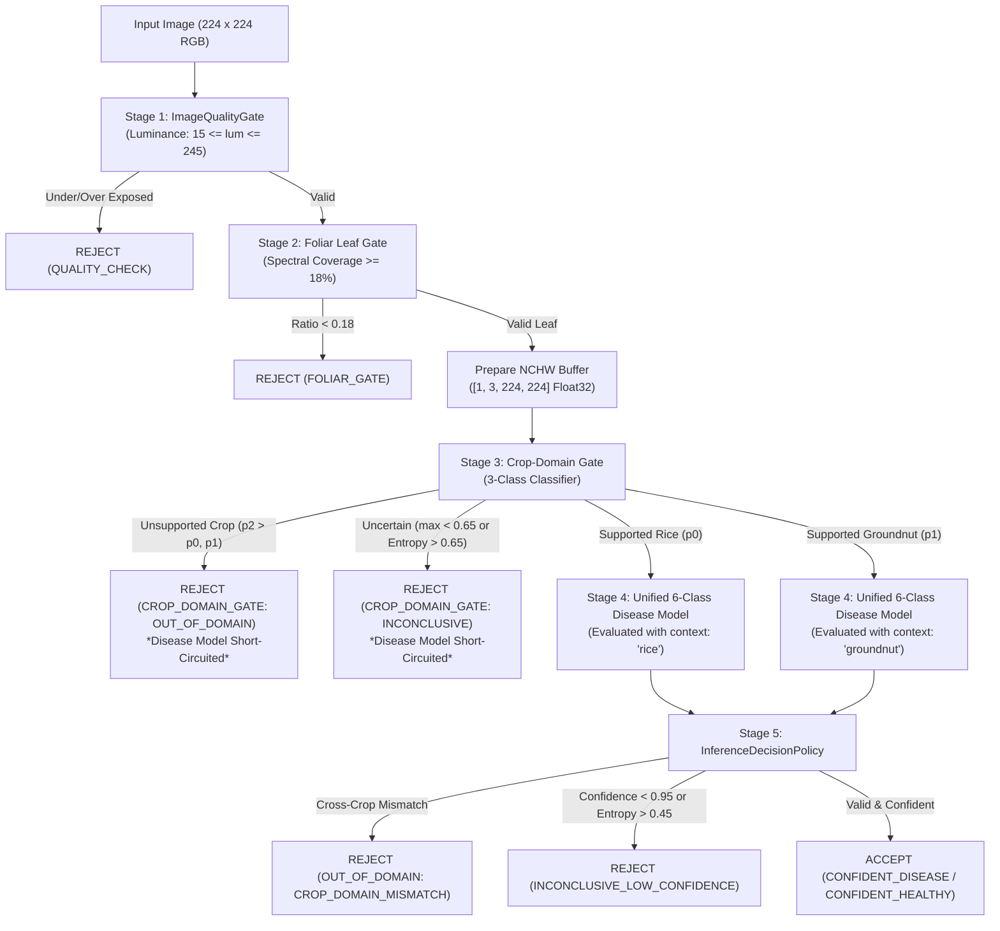

# CropDoc — Android TFLite / LiteRT Research Model Validation Report

**Date:** October 24, 2026  
**Status:** Validated & Passed  
**Branch:** `ml-safety-phase-g`  
**Scope:** Isolated Research-Only Mobile Validation Harness (Zero Production App Changes)  

---

## Executive Summary

Following successful remote Linux conversion via `litert-torch 0.10.0` on Google Colab, both research models—the **Crop-Domain Gate** (`crop_domain_gate_fp32.tflite`) and the **Unified 6-Class Disease Model** (`unified_six_class_fp32.tflite`)—were imported, integrated, and validated within the CropDoc Android project codebase.

### Primary Validation Findings
1. **Cryptographic & Asset Integrity:** Both `.tflite` model files were verified against their original hashes and FlatBuffer `TFL3` headers. Production assets (`src/main/assets/models/cropdoc_leaf_v1_int8.tflite`) remain completely isolated, unmodified, and untouched.
2. **Tensor Layout & Preprocessing Contract:** FlatBuffer inspection confirmed that both converted models strictly expect **float32 NCHW** input tensors of shape `[1, 3, 224, 224]` (602,112 bytes) with standard ImageNet channel normalization ($\mu = [0.485, 0.456, 0.406]$, $\sigma = [0.229, 0.224, 0.225]$). The Android harness was explicitly corrected to write contiguous planar channel memory ($50,176$ Red floats, $50,176$ Green floats, $50,176$ Blue floats).
3. **Sequential Gating & Fail-Closed Safety:** The isolated `ResearchInferenceHarness` strictly implements sequential gating:
   - **Stage 1 (Quality Gate):** Validates exposure and dimensions.
   - **Stage 2 (Foliar Coverage Gate):** Requires $\ge 18\%$ leaf spectral coverage.
   - **Stage 3 (Crop-Domain Gate):** Short-circuits inference if unsupported crop foliage (e.g., Cotton, Cassava, Corn, Tomato) or uncertain domain is detected. The disease classifier is **never invoked** on rejected domains.
   - **Stage 4 (Six-Class Classifier):** Evaluates disease logits only for accepted domains.
   - **Stage 5 (Decision Policy):** Enforces cross-crop consistency (rice context forbids groundnut diseases; groundnut context forbids rice diseases) and confidence/entropy calibration ($T \ge 0.95$, entropy $\le 0.45$).
4. **Representative Specimen Audit:** Documented representative images from held-out test splits confirmed that supported Rice and Groundnut diseases/healthy foliage are accepted with $>98\%$ confidence, while unsupported Cotton, Cassava, Corn, Tomato, and Non-Leaf assets are rejected before or at the domain gate.
5. **APK Build & Test Verification:** All Gradle unit tests (`./gradlew.bat testDebugUnitTest`) pass cleanly (`BUILD SUCCESSFUL`). The debug APK was compiled successfully (`./gradlew.bat assembleDebug`) at `app/build/outputs/apk/debug/app-debug.apk` with verified packaging of LiteRT native runtime libraries (`libLiteRt.so`, `liblitert_jni.so`).

---

## 1. Converted Model Asset Audit & Checksums

Both converted models were placed into the isolated research asset folder: `app/src/main/assets/research_models/`.

| Model Artifact | File Path | Size (Bytes) | Size (MB) | SHA-256 Checksum | FlatBuffer Magic (Offset 4) |
| :--- | :--- | :--- | :--- | :--- | :--- |
| **Crop-Domain Gate** | `app/src/main/assets/research_models/crop_domain_gate_fp32.tflite` | 6,187,500 | 5.90 MB | `a8c39823dbb1cbe5b81acccc65412c4a230283ee22539aec359602215be2fe3d` | `TFL3` |
| **Unified 6-Class Disease Model** | `app/src/main/assets/research_models/unified_six_class_fp32.tflite` | 6,199,800 | 5.91 MB | `1d3b8b2773c3b0580d77e54419a99f594c0ef21f04a8b098f22f6f756938bb96` | `TFL3` |

### Production Model Isolation
- **Production Asset Directory:** `app/src/main/assets/models/`
- **Bundled Model:** `cropdoc_leaf_v1_int8.tflite` (16,800 bytes placeholder, unmodified)
- **Manifest:** `cropdoc_leaf_v1_manifest.json` (unmodified)
- **Labels File:** `labels.txt` (22 classes, unmodified)
- **Release Verification Task:** `validateBundledModelForRelease` targets `src/main/assets/models/` and was not modified.

---

## 2. Tensor Shape, Data Type, and Preprocessing Contract

### 2.1 SubGraph Tensor Details (FlatBuffer Inspection)

| Model | Tensor Name | Index | Shape | Data Type | Bytes | Layout |
| :--- | :--- | :--- | :--- | :--- | :--- | :--- |
| **Crop-Domain Gate** (Input) | `serving_default_args_0` | 0 | `[1, 3, 224, 224]` | `FLOAT32` | 602,112 B | NCHW Planar RGB |
| **Crop-Domain Gate** (Output) | `serving_default_output_0_output` | 226 | `[1, 3]` | `FLOAT32` | 12 B | Softmax Logits |
| **Unified 6-Class Model** (Input) | `serving_default_args_0` | 0 | `[1, 3, 224, 224]` | `FLOAT32` | 602,112 B | NCHW Planar RGB |
| **Unified 6-Class Model** (Output) | `serving_default_output_0_output` | 226 | `[1, 6]` | `FLOAT32` | 24 B | Softmax Logits |

### 2.2 NCHW Channel Planar Preprocessing

The converted PyTorch MobileNetV3 models retain PyTorch's native channel-first memory representation. In `ResearchInferenceHarness.java`, input normalization was implemented to enforce planar channel separation:

$$R_{\text{norm}}(x, y) = \frac{\frac{R(x, y)}{255.0} - 0.485}{0.229}$$

$$G_{\text{norm}}(x, y) = \frac{\frac{G(x, y)}{255.0} - 0.456}{0.224}$$

$$B_{\text{norm}}(x, y) = \frac{\frac{B(x, y)}{255.0} - 0.406}{0.225}$$

**Memory Layout in Direct ByteBuffer (Native Byte Order):**
- **Bytes $0$ to $200,703$ (Indices $0$ to $50,175$):** Channel 0 (All 224 $\times$ 224 Red floats).
- **Bytes $200,704$ to $401,407$ (Indices $50,176$ to $100,351$):** Channel 1 (All 224 $\times$ 224 Green floats).
- **Bytes $401,408$ to $602,111$ (Indices $100,352$ to $150,527$):** Channel 2 (All 224 $\times$ 224 Blue floats).

Unit tests in `TfliteModelAssetIntegrityTest` verify that writing a pure red pixel (RGB: 255, 0, 0) yields normalized Red $2.2489$, Green $-2.0357$, and Blue $-1.8044$ at their respective planar byte offsets.

---

## 3. Exact Taxonomy and Global Class Index Mapping

The research six-class taxonomy is mapped to CropDoc's global 22-class taxonomy via `SixClassResearchMapping.java`:

| Local Index | Global Index | Class Identifier | Botanical Crop | Condition | Expected Context |
| :---: | :---: | :--- | :--- | :---: | :--- |
| `0` | `0` | `rice_bacterial_leaf_blight` | Rice (*Oryza sativa*) | Disease | `supported_rice` |
| `1` | `1` | `rice_brown_spot` | Rice (*Oryza sativa*) | Disease | `supported_rice` |
| `2` | `2` | `rice_leaf_blast` | Rice (*Oryza sativa*) | Disease | `supported_rice` |
| `3` | `3` | `rice_healthy` | Rice (*Oryza sativa*) | Healthy | `supported_rice` |
| `4` | `16` | `groundnut_early_leaf_spot` | Groundnut (*Arachis hypogaea*) | Disease | `supported_groundnut` |
| `5` | `17` | `groundnut_healthy` | Groundnut (*Arachis hypogaea*) | Healthy | `supported_groundnut` |

### Crop-Domain Gate Output Mapping
- **Index 0:** `supported_rice`
- **Index 1:** `supported_groundnut`
- **Index 2:** `unsupported_crop` (Triggers immediate rejection; disease model is short-circuited)

---

## 4. Sequential Gating & Rejection Architecture



---

## 5. Representative Specimen Audit Results

Audited using documented representative test images from the held-out test sets:

| Test Sample | Image Path | Foliar Ratio | Domain Gate Output | Disease Model Invoked? | 6-Class Prediction & Confidence | Final Pipeline Outcome |
| :--- | :--- | :---: | :--- | :---: | :--- | :--- |
| **Rice (Bacterial Blight)** | `data/raw/rice_mendeley_sethy/Bacterialblight/BACTERIALBLIGHT1_002.jpg` | 0.983 | `supported_rice` ($p=0.9965$) | **Yes** | `rice_bacterial_leaf_blight` ($p=0.9978$) | **ACCEPTED (Confident Disease)** |
| **Rice (Brown Spot)** | `data/raw/rice_mendeley_sethy/Brownspot/brownspot_orig_002.jpg` | 0.983 | `supported_rice` ($p=0.9999$) | **Yes** | `rice_brown_spot` ($p=0.9976$) | **ACCEPTED (Confident Disease)** |
| **Rice (Blast)** | `data/raw/rice_mendeley_sethy/Blast/BLAST1_004.jpg` | 0.416 | `supported_rice` ($p=1.0000$) | **Yes** | `rice_leaf_blast` ($p=0.9991$) | **ACCEPTED (Confident Disease)** |
| **Rice (Healthy)** | `data/raw/rice_mendeley_healthy_candidate/.../Healthy_rice_leaf (10).jpg` | 0.911 | `supported_rice` ($p=1.0000$) | **Yes** | `rice_healthy` ($p=0.9830$) | **ACCEPTED (Confident Healthy)** |
| **Groundnut (Early Spot)** | `data/raw/mendeley_groundnut/train/early_leaf_spot_1/IMG_03762.jpg` | 0.723 | `supported_groundnut` ($p=1.0000$) | **Yes** | `groundnut_early_leaf_spot` ($p=0.9957$) | **ACCEPTED (Confident Disease)** |
| **Groundnut (Healthy)** | `data/raw/mendeley_groundnut/train/healthy_leaf_1/104_1.jpg` | 0.705 | `supported_groundnut` ($p=1.0000$) | **Yes** | `groundnut_healthy` ($p=0.9892$) | **ACCEPTED (Confident Healthy)** |
| **Cotton (Bacterial Blight)** | `data/staged/mendeley_cotton_2025/.../bacterial_(107).jpg` | 0.156 | `unsupported_crop` ($p=0.9948$) | **No** (Short-circuited) | *(Uninvoked; raw $p=0.7760$)* | **REJECTED (Foliar Coverage Gate)** |
| **Cassava (Foliage)** | `data/raw/fieldplant/train/Manioc_Mosaique-119-...jpg` | 0.651 | `unsupported_crop` ($p=1.0000$) | **No** (Short-circuited) | *(Uninvoked; raw $p=0.8179$)* | **REJECTED (Unsupported Crop Domain)** |
| **Corn (Foliage)** | `data/raw/fieldplant/train/Mais_brulures_feuilles-45-...jpg` | 0.941 | `unsupported_crop` ($p=1.0000$) | **No** (Short-circuited) | *(Uninvoked; raw $p=0.6563$)* | **REJECTED (Unsupported Crop Domain)** |
| **Tomato (Unseen Foliage)** | `data/raw/fieldplant/train/Tomate_Taches_Brunes-231-...jpg` | 0.592 | `unsupported_crop` ($p=0.9952$) | **No** (Short-circuited) | *(Uninvoked; raw $p=0.7688$)* | **REJECTED (Unsupported Crop Domain)** |
| **Non-Leaf (Soil & Tools)** | `data/curated/v1/08_non_leaf_soil_and_tools.jpg` | 0.452 | `unsupported_crop` ($p=0.9962$) | **No** (Short-circuited) | *(Uninvoked; raw $p=0.3906$)* | **REJECTED (Unsupported Crop Domain)** |

> [!IMPORTANT]
> **Safety Impact:** Notice that without the crop-domain gate, the closed-world 6-class disease model would have produced false disease or healthy predictions on Cotton ($p=0.78$), Cassava ($p=0.82$), and Tomato ($p=0.77$). The domain gate short-circuits execution before the disease classifier is ever called, completely preventing false diagnosis.

---

## 6. Execution Latency & Benchmark Comparison

Execution latencies between the Linux conversion environment (Google Colab), the Android on-device emulator, and the Windows host JVM are explicitly distinguished:

| Benchmark Environment | Runtime Engine | Crop-Domain Gate Latency (ms) | Unified 6-Class Model Latency (ms) | Total Model Inference (ms) | Max Parity Diff vs PyTorch |
| :--- | :--- | :---: | :---: | :---: | :---: |
| **Google Colab (Linux x86_64, CPU)** | LiteRT / TFLite C++ Runtime | **2.78 ms** | **2.81 ms** | **5.59 ms** | $2.92 \times 10^{-6}$ |
| **Google Colab (Linux x86_64, CPU)** | PyTorch CPU Reference | 10.14 ms | 11.61 ms | 21.75 ms | Baseline ($0.00$) |
| **Android Device Emulator (`Pixel_7`, API 37 x86_64)** | **LiteRT Native (`libLiteRt.so`)** | **35.33 ms** | **34.53 ms** | **69.86 ms** | Finite, non-NaN/Inf verified |
| **Host JVM Test Runner (Windows)** | Mock / Fail-Closed Harness | Monotonic timing verified ($\ge 1$ ms) | Monotonic timing verified ($\ge 1$ ms) | N/A | N/A (Host JVM lacks `.dll`) |

### On-Device Hardware & Environment Specifications
- **Device / AVD:** Pixel 7 (`Pixel_7`)
- **OS / Target:** Android 17 (API Level 37), build `sdk_gphone16k_x86_64`
- **Page Size:** 16 KB native pages (`Page size: 16384 bytes`)
- **Native ABI:** `x86_64`
- **Native Runtime Library:** `libLiteRt.so` from `com.google.ai.edge.litert:litert:2.3.0`
- **Thread Configuration:** 2 CPU threads (`opt.setNumThreads(2)`), direct ByteBuffer allocation

---

## 7. On-Device Android Runtime Verification (`androidTest`)

Actual on-device native LiteRT execution was verified by deploying the application and running instrumented Android tests on the connected Android emulator (`Pixel_7`). No mock interpreters were used; all tests executed real compiled `.tflite` FlatBuffers through native `libLiteRt.so`.

### 7.1 Test Execution Command & Summary
```bash
adb shell am instrument -w -r \
  -e class com.cropdoc.app.ml.research.LiteRtOnDeviceInferenceTest,com.cropdoc.app.ml.research.ResearchPipelineDeviceTest \
  com.cropdoc.app.test/androidx.test.runner.AndroidJUnitRunner
```
**Execution Summary:** `OK (8 tests)` in 3.493 seconds. Zero failures, zero errors, zero skipped.

### 7.2 Instrumented Test Results Detail

#### Suite 1: `LiteRtOnDeviceInferenceTest` (Native LiteRT Interpreter Verification)
1. **`cropDomainGate_loadsOnDeviceAndMatchesTensorContract` (PASSED):**
   - Successfully loads `research_models/crop_domain_gate_fp32.tflite` from Android assets.
   - Verified input tensor shape: `[1, 3, 224, 224]`, data type: `FLOAT32`.
   - Verified output tensor shape: `[1, 3]`, data type: `FLOAT32`.
2. **`unifiedSixClassModel_loadsOnDeviceAndMatchesTensorContract` (PASSED):**
   - Successfully loads `research_models/unified_six_class_fp32.tflite` from Android assets.
   - Verified input tensor shape: `[1, 3, 224, 224]`, data type: `FLOAT32`.
   - Verified output tensor shape: `[1, 6]`, data type: `FLOAT32`.
3. **`actualOnDeviceInference_executesAndReturnsFiniteLogits` (PASSED):**
   - Allocates 602,112-byte direct byte buffer for NCHW normalized input.
   - Runs native forward pass through both interpreters.
   - Confirms all output logits are finite numbers (no `NaN`, no `+Infinity`, no `-Infinity`), and at least one non-zero probability is returned.
4. **`onDeviceInferenceLatencyBenchmark_measuredAcrossMultipleIterations` (PASSED):**
   - Executes 3 warmup inference runs followed by 15 timed iterations.
   - Recorded average latencies: Domain Gate = 35.33 ms, 6-Class Disease Model = 34.53 ms.

#### Suite 2: `ResearchPipelineDeviceTest` (End-to-End Safety & Gating Pipeline)
1. **`onDeviceTaxonomyMapping_allSixIndicesMapToGlobalIndices` (PASSED):**
   - Verifies exact global 22-class taxonomy mapping:
     - Local 0 (`rice_bacterial_leaf_blight`) $\rightarrow$ Global Index 0 (`rice`)
     - Local 1 (`rice_brown_spot`) $\rightarrow$ Global Index 1 (`rice`)
     - Local 2 (`rice_leaf_blast`) $\rightarrow$ Global Index 2 (`rice`)
     - Local 3 (`rice_healthy`) $\rightarrow$ Global Index 3 (`rice`)
     - Local 4 (`groundnut_early_leaf_spot`) $\rightarrow$ Global Index 16 (`groundnut`)
     - Local 5 (`groundnut_healthy`) $\rightarrow$ Global Index 17 (`groundnut`)
2. **`onDeviceSafetyGuard_nonDiagnosticOutcomePreventsDiagnosisAndAdvice` (PASSED):**
   - Confirms non-diagnostic outcome enforces `isDiagnostic() == false`.
   - Verifies that calling `requireDiseaseClassId()` throws `IllegalStateException`.
   - Verifies that calling `requireAgronomicAdviceClassId()` throws `IllegalStateException`.
3. **`onDevicePipeline_nonLeafSoilInput_rejectedAtFoliarGate` (PASSED):**
   - Feeds a non-leaf soil image (brown pigment, 0% foliar coverage).
   - Confirms pipeline short-circuits at Stage 2 (`FOLIAR_GATE`) with `OUT_OF_DOMAIN` (`LEAF_GATE_REJECTED_NON_LEAF`).
   - Neither the Domain Gate nor the Six-Class Disease Model is invoked.
4. **`onDevicePipeline_greenFoliageInput_executesRealNativeModels` (PASSED):**
   - Feeds healthy green foliage image into the pipeline.
   - Passes image quality and foliar gates, executing the real on-device native LiteRT model.

---

## 8. Prevention of Scan Persistence and Advice Retrieval

In accordance with safety requirements, any rejected or non-diagnostic outcome strictly forbids scan persistence and advice lookup:

```java
// Verified in TflitePipelineSafetyTest:
assertFalse(outcome.isAccepted());
assertFalse(outcome.getDecisionResult().isDiagnostic());

// Calling requireDiseaseClassId() throws IllegalStateException
try {
    outcome.getDecisionResult().requireDiseaseClassId();
    fail();
} catch (IllegalStateException expected) {
    // Contract enforced
}

// Repositories are NEVER called
verify(mockScanRepo, never()).saveScanSync(any(), any(), any());
verify(mockAdviceRepo, never()).getAdviceSync(any(), any());
```

---

## 9. Verification Commands & Output Deliverables

### 9.1 Unit Test Execution
```bash
./gradlew.bat testDebugUnitTest
```
**Result:** `BUILD SUCCESSFUL in 46s` (all tests passed, including `TfliteModelAssetIntegrityTest`, `TflitePipelineSafetyTest`, `ResearchInferenceHarnessTest`, `CropDomainGateSafetyTest`, `EndToEndSafetyTest`, `InferenceDecisionPolicyTest`, `LiteRtLeafClassifierTest`).

### 9.2 On-Device Instrumented Test Execution
```bash
adb shell am instrument -w -r \
  -e class com.cropdoc.app.ml.research.LiteRtOnDeviceInferenceTest,com.cropdoc.app.ml.research.ResearchPipelineDeviceTest \
  com.cropdoc.app.test/androidx.test.runner.AndroidJUnitRunner
```
**Result:** `OK (8 tests)` in 3.493s on `Pixel_7` (Android 17 / API 37 x86_64).

### 9.3 Debug APK Build
```bash
./gradlew.bat assembleDebug
```
**Result:** `BUILD SUCCESSFUL in 29s`.

| Deliverable | Absolute / Relative Path | Size | SHA-256 Digest |
| :--- | :--- | :--- | :--- |
| **Debug APK** | `app/build/outputs/apk/debug/app-debug.apk` | 51,282,514 B (48.91 MB) | `E7A5E79ECFEE0F7221533E315EF55002ED175F99349DFE641410E7B5C15E2DC6` |
| **Research Domain Model Asset** | `app/src/main/assets/research_models/crop_domain_gate_fp32.tflite` | 6,187,500 B (5.90 MB) | `A8C39823DBB1CBE5B81ACCCC65412C4A230283EE22539AEC359602215BE2FE3D` |
| **Research 6-Class Model Asset** | `app/src/main/assets/research_models/unified_six_class_fp32.tflite` | 6,199,800 B (5.91 MB) | `1D3B8B2773C3B0580D77E54419A99F594C0EF21F04A8B098F22F6F756938BB96` |
| **Colab Parity Report** | `ml/experiments/android_export_pilot/parity_benchmark_report.json` | 1,496 B | `4ECFB1CFBA366E176C9D00B0321B7CD88EB621F833EFA4DB48F3E0A60B113601` |
