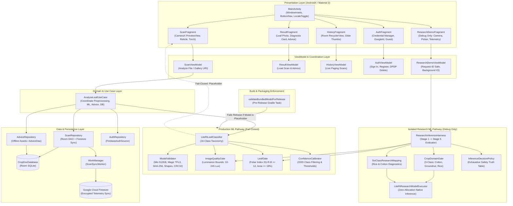

# Phase C: Architecture and End-to-End Application Flow

**Audit Date:** 2026-10-24T23:28:00+05:30  
**Project:** CropDoc (`com.cropdoc.app`)  
**Auditor:** Senior Android Architect, ML Systems Engineer  

---

## 1. High-Level System Architecture Diagram

---

## 2. End-to-End Traces of Critical Application Pathways

### Pathway 1: Application Initialization & Dependency Graph
1. Android OS instantiates `CropDocApplication` (`app/src/main/AndroidManifest.xml` line 14).
2. `CropDocApplication.onCreate()`:
   - Instantiates `AppContainer` (manual dependency injection container).
   - In debug builds: Enables `StrictMode` for disk, network, and SQLite leak detection.
   - Executes `initFirebaseAndAppCheckSafely()`: wraps Firebase initialization in a defensive `try-catch` to allow 100% offline usage without `google-services.json`.
3. `MainActivity.onCreate()`:
   - Enables `EdgeToEdge.enable(this)`.
   - `WindowInsetsHelper.applyShellInsets()` binds padding for status bar, navigation bar, and IME display cuts.
   - Binds `NavController` to `NavHostFragment`.
   - If `BuildConfig.DEBUG == true`, dynamically adds the `researchDemoFragment` tab to `BottomNavigationView`.
   - Initializes trilingual toggle group (English, Hindi, Telugu) syncing with `LocaleHelper.getCurrentLanguageCode()`.

---

### Pathway 2: Production Camera Scan & Fail-Closed Diagnostics
1. **User Action:** User navigates to Scan tab and taps Capture Leaf Photo (`ScanFragment.java`).
2. **CameraX Capture:**
   - Evaluates `Manifest.permission.CAMERA`. If denied, presents permission card with inline settings resolution.
   - `ImageCapture.takePicture()` writes raw JPEG to app cache directory (`cacheDir/raw_<timestamp>.jpg`).
3. **Execution Offloading:**
   - Captured file path and reticle bounding coordinates are passed to `ScanViewModel.analyzeImageFile()`.
   - Execution dispatches to `AppExecutors.mlInference()` background thread via `AnalyzeLeafUseCase.execute()`.
4. **Production ML Pipeline (`LiteRtLeafClassifier.java`):**
   - **Step 4A (Integrity Validation):** Calls `ModelValidator.validateModelAsset()`. Evaluates `assets/models/cropdoc_leaf_v1_int8.tflite`.
   - **Detection:** The model length is 16,800 bytes ($< 524,288$ bytes minimum).
   - **Safe Containment:** Validation fails immediately. Classifier returns `ClassificationOutcome.ModelUnavailable`.
5. **UI Notification:**
   - LiveData delivers `ClassificationOutcome.ModelUnavailable` to `ScanFragment`.
   - `ScanFragment` renders Snackbar: *"Diagnosis is currently unavailable. A verified model update is required."* (`R.string.status_model_unavailable`).
   - Zero database writes occur; no false agronomic treatment is emitted.

---

### Pathway 3: Isolated Research Inference Pipeline
1. **User Action:** In debug builds, user navigates to the Research tab (`ResearchDemoFragment.java`).
2. **Input Modes Supported:**
   - Photo Capture: Uses `ActivityResultContracts.TakePicture()` saving to FileProvider cache URI.
   - Gallery Selection: Uses `ActivityResultContracts.PickVisualMedia()`.
   - Bundled Samples: Genuine Rice Leaf photo or Genuine Non-Leaf Soil photo (`sample_non_leaf_soil.jpg`).
3. **Thread Safety & Request ID Protection:**
   - `ResearchDemoViewModel.analyzeUri()` increments an atomic `requestId`.
   - Sets state immediately to `ANALYZING`, clearing previous latency measurements and cached results.
   - Dispatches to background thread pool (`AppExecutors.networkIO()`).
4. **Multi-Stage Gated Execution (`ResearchInferenceHarness.java`):**
   - **Stage 1 (Image Quality Gate):** Evaluates mean luminance. If outside [10, 245] lux $\rightarrow$ Rejects with `IMAGE_QUALITY_OUT_OF_BOUNDS`.
   - **Stage 2 (Foliar Coverage Gate):** Calculates colorimetric green index $2G - R - B \ge 12$. If leaf area $< 18\%$ $\rightarrow$ Rejects with `LEAF_GATE_REJECTED_NON_LEAF`. Subsequent stages are bypassed and marked `NOT RUN` with `-1L` latency.
   - **Stage 3 (Crop Domain Gate):** Executes `crop_domain_gate_fp32.tflite` via LiteRT. Evaluates softmax probabilities across `[cotton, groundnut, rice]`. If maximum probability $< 0.85$ or confidence margin $< 0.15$ $\rightarrow$ Rejects as `OUT_OF_DOMAIN`.
   - **Stage 4 (Six-Class Disease Model):** If Stage 3 passes, executes `unified_six_class_fp32.tflite`.
   - **Stage 5 (Inference Decision Policy):** Evaluates cross-domain consistency matrix and calibrates final confidence.
5. **Presentation & Strict Isolation:**
   - Result reaches `ResearchDemoFragment` through LiveData.
   - Formatted by `ResearchUiFormatter` in the selected locale (English, Hindi, or Telugu).
   - **Crucial Boundary:** Research outcomes are **never** passed to `ScanRepository`, **never** saved to Room database, and **never** trigger production advice.

---

### Pathway 4: In-App Language Switching
1. User taps language button (`EN`, `HI`, or `TE`) in the persistent header.
2. `MainActivity` calls `LocaleHelper.applyLanguage(selectedTag)`.
3. `LocaleHelper` updates `AppCompatDelegate.setApplicationLocales(LocaleListCompat.forLanguageTags(selectedTag))`.
4. AndroidX AppCompat automatically recreates active fragments with the qualified resource configurations (`values/`, `values-hi/`, `values-te/`).
5. Process does **not** restart, preserving user session and navigation backstack.

---

### Pathway 5: Release Build Verification (`preReleaseBuild`)
1. Gradle task `validateBundledModelForRelease` executes before R8 or DEX compilation.
2. Evaluates model byte length, TFLite magic identifier (`TFL3`), SHA-256 cryptographic digest against manifest, label CRC32 checksum, and tensor shape/dtype graph inspection.
3. If the model asset is a placeholder, Gradle throws `GradleException` and halts compilation with Exit Code 1.
