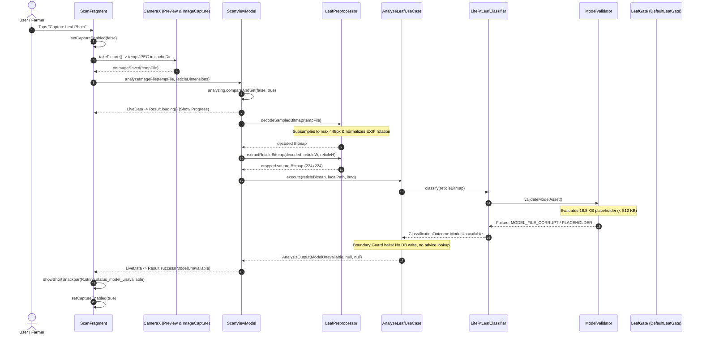

# Phase E: Production Camera and Scan Workflow Audit

**Audit Date:** 2026-10-24T23:32:00+05:30  
**Project:** CropDoc (`com.cropdoc.app`)  
**Auditor:** Senior Android Architect, Mobile Hardware & Computer Vision Specialist  

---

## 1. Executive Summary: Production Scanner Health

The production camera scan workflow in [`com.cropdoc.app.ui.scan`](file:///C:/Users/ojas/OneDrive/Desktop/MajorProjectMAD/CropDoc/app/src/main/java/com/cropdoc/app/ui/scan) is structurally sound, memory-efficient, and strictly isolated from the experimental research pipeline.

When a user captures or selects an image on the production Scan screen, the application displays:
> **"Diagnosis is currently unavailable. A verified model update is required."**  
> (`R.string.status_model_unavailable`)

### Core Verification Finding
- **Is this warning caused by a defect in CameraX, image decoding, or threading?**  
  **NO.** CameraX photo capture, gallery picking, EXIF rotation handling, reticle cropping, and thread dispatch are functioning as designed.
- **Root Cause:** The production model asset [`cropdoc_leaf_v1_int8.tflite`](file:///C:/Users/ojas/OneDrive/Desktop/MajorProjectMAD/CropDoc/app/src/main/assets/models/cropdoc_leaf_v1_int8.tflite) is a 16.8 KB placeholder.
- **Fail-Closed Gate:** [`ModelValidator.java`](file:///C:/Users/ojas/OneDrive/Desktop/MajorProjectMAD/CropDoc/app/src/main/java/com/cropdoc/app/ml/ModelValidator.java) enforces a minimum byte size of 512 KB (`MIN_REAL_MODEL_BYTES`). Detecting that 16.8 KB $< 512$ KB, it returns `ValidationResult.failure(ClassificationOutcome.UnavailableReason.MODEL_FILE_CORRUPT)`.
- [`LiteRtLeafClassifier`](file:///C:/Users/ojas/OneDrive/Desktop/MajorProjectMAD/CropDoc/app/src/main/java/com/cropdoc/app/ml/LiteRtLeafClassifier.java) returns `ClassificationOutcome.ModelUnavailable`.
- [`ScanFragment`](file:///C:/Users/ojas/OneDrive/Desktop/MajorProjectMAD/CropDoc/app/src/main/java/com/cropdoc/app/ui/scan/ScanFragment.java) surfaces this via a Snackbar. **Crucially**, it navigates nowhere, performs zero database writes, and refuses to emit fabricated diagnoses.

---

## 2. End-to-End Workflow Breakdown

---

## 3. Workflow Subsystem Audit

### A. Permission & Hardware State
- **Permission Model:** Uses modern `ActivityResultContracts.RequestPermission()` for `Manifest.permission.CAMERA`.
- **Permission Denial Handling:** Displays a dedicated permission banner (`binding.cardCameraPermission`) with dynamic action buttons:
  - If `shouldShowRequestPermissionRationale == true`: Shows "Grant Camera" (`R.string.action_grant_camera`).
  - If permanently denied ("Don't ask again"): Directs farmer to system settings (`R.string.action_open_settings`).
- **Torch / Flash Support:** Queries `activeCamera.getCameraInfo().hasFlashUnit()`. Torch toggle is dynamically hidden on hardware lacking a flash LED.

### B. CameraX Implementation
- **Lifecycle Safety:** Binds use cases (`Preview`, `ImageCapture`) to `getViewLifecycleOwner()` instead of Fragment lifecycle, preventing leaks on configuration change.
- **Camera Selection:** Prioritizes back camera (`DEFAULT_BACK_CAMERA`) with automatic fallback to front camera (`DEFAULT_FRONT_CAMERA`) for hardware compatibility.
- **ViewBinding Cleanliness:** `binding = null` and `activeCamera = null` in `onDestroyView()`.

### C. Image Preprocessing & Memory Safety
- **Downsampling on Decode:** `LeafPreprocessor.decodeSampledBitmap()` uses `inJustDecodeBounds = true` and `calculateInSampleSize()` targeting a maximum dimension of 448 px.
  - Prevents Out-Of-Memory (OOM) crashes on 48 MP / 108 MP smartphone sensors.
- **EXIF Orientation:** Inspects `ExifInterface.TAG_ORIENTATION` and rotates bitmaps via `Matrix.postRotate()`.
- **Viewfinder Reticle Alignment:** Extracts the exact square corresponding to the on-screen reticle box (`leafReticleBox`), eliminating background clutter.
- **EXIF Privacy Sanitization:** Strips all GPS location data and camera hardware serial numbers before persisting local JPEG files (`ExifPrivacySanitizer.saveSanitizedLeafJpeg()`).
- **Bitmap Recycling:** Bitmaps are recycled in a `finally` block in `ScanViewModel.runDecodeAndAnalyze()`.

---

## 4. Failure Mode and Handling Matrix

| Situation / Vector | Current Handling | UI Representation | Database / Persistence Impact | Safe? |
| :--- | :--- | :--- | :--- | :--- |
| **Camera Permission Denied** | Displays permission card inline; disables capture. | Inline Card + Settings Intent | No DB write | **YES** |
| **Camera Hardware Failure** | Catches `ImageCaptureException`. Re-enables capture buttons. | Snackbar: `error_camera_capture` | No DB write | **YES** |
| **Image Decoding Failure** | Catches `Throwable` in `decodeSampledBitmap()`. | Snackbar: `error_image_decode_failed` | No DB write | **YES** |
| **Model Unavailable (Placeholder)** | `ModelValidator` aborts; returns `ModelUnavailable`. | Snackbar: `status_model_unavailable` | No DB write | **YES** |
| **Gate Unvalidated** | `DefaultLeafGate` returns `uncertain()`. | Snackbar: `status_model_unavailable` | No DB write | **YES** |
| **Image Rejected (Dark/Overexposed)** | `ImageQualityGate` rejects luminance $<10$ or $>245$ lux. | Snackbar: `status_image_rejected` | No DB write | **YES** |
| **Low Confidence / Unclear Leaf** | Max softmax confidence $< 0.65$ or entropy $> 0.70$. | Snackbar: `status_low_confidence_retake` | No DB write | **YES** |
| **Successful Diagnosis (When Real Model Installed)** | High confidence disease prediction. | Navigates to `ResultFragment` with Scan ID | Writes to Room `ScanDao`; enqueues WorkManager sync | **YES** |

---

## 5. Potential Independent Scanning Defects Investigated

1. **Double-Tap / Multi-Tap Concurrency:**
   - Evaluated: Rapidly tapping the scan shutter button.
   - Status: **PASSED.** `ScanViewModel.analyzing.compareAndSet(false, true)` immediately rejects concurrent executions, and `setCaptureEnabled(false)` disables the UI button.
2. **Gallery Picker URI Lifespan:**
   - Evaluated: Selecting image from external cloud/Google Photos via Photo Picker.
   - Status: **PASSED.** `ScanViewModel.analyzeGalleryUri()` immediately streams the URI bytes to a local temporary cache file off the main thread before decoding.
3. **Temporary Cache Accumulation:**
   - Evaluated: Creation of `raw_<timestamp>.jpg` files in `cacheDir`.
   - Status: **Minor Finding (JAVA-03).** Successfully analyzed files are deleted via `deleteTempRawFile()`. However, if `imageCapture.takePicture()` throws an exception inside CameraX, the temp file remains in cache until OS cleanup.
