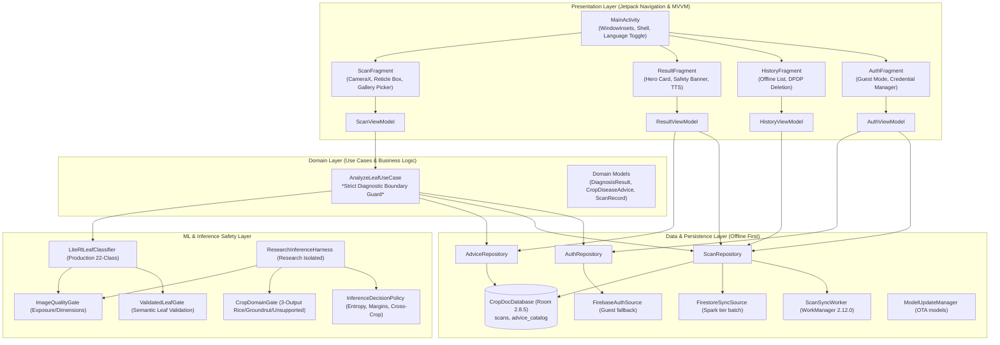
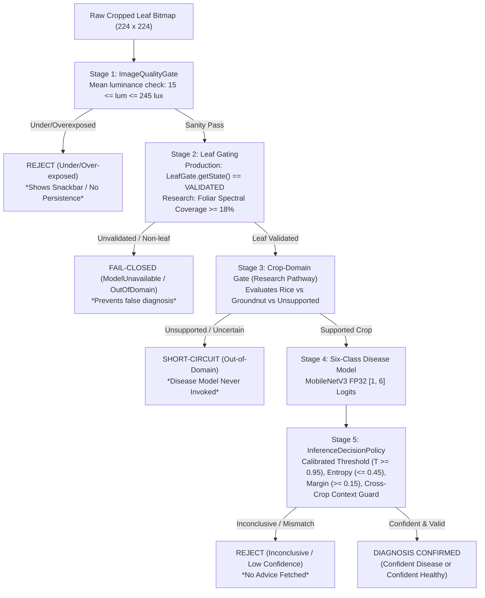

# CropDoc — Android Architecture and Execution Flow Audit

**Date:** October 24, 2026  
**Auditor:** Senior Android Application Architect  
**Scope:** Complete Architecture, Lifecycle, Concurrency, and Data Flow Audit  

---

## 1. High-Level Architectural Overview

CropDoc follows the **Modern Android Architecture** recommendations, employing a **Single-Activity, Fragment-based MVVM (Model-View-ViewModel)** design with strict separation of concerns across Presentation, Domain, Data, and ML Inference layers. Manual Dependency Injection is orchestrated via `AppContainer`, avoiding annotation processing and reflection overhead at runtime.



---

## 2. Detailed Execution Flows

### 2.1 Leaf Image Acquisition & Preprocessing Flow
1. **Camera Capture or Gallery Pick:**
   - In `ScanFragment`, camera preview is managed via **CameraX 1.6.2** (`Preview`, `ImageCapture`).
   - The user aligns the crop leaf within a square 1:1 reticle box.
   - Alternatively, the user picks an image using the Android Photo Picker (`PickVisualMediaRequest`).
2. **Concurrency & Thread Safety:**
   - `ScanViewModel` enforces an atomic double-tap concurrency guard (`AtomicBoolean analyzing = new AtomicBoolean(false)`) using `compareAndSet(false, true)`.
   - Gallery stream copying runs on `executors.diskIo()`.
   - Bitmap decoding and analysis execute on a dedicated single-threaded executor (`executors.mlInference()`).
3. **Isotropic Cropping & Sanitization:**
   - `LeafPreprocessor.decodeSampledBitmap()` subsamples image decoding based on EXIF rotation (`ExifInterface`).
   - `LeafPreprocessor.extractReticleBitmap()` performs an isotropic square crop matching the camera viewfinder aspect ratio, preventing non-isotropic distortion.
   - `ExifPrivacySanitizer.saveSanitizedLeafJpeg()` strips sensitive GPS/device metadata to satisfy DPDP Act privacy requirements before saving to internal app storage.

---

### 2.2 Inference Gating & Decision Flow



---

### 2.3 Diagnostic Boundary Guard & Offline Persistence Flow

A critical architectural safeguard in `AnalyzeLeafUseCase` enforces that **only genuine `ClassificationOutcome.Diagnosis` instances may ever trigger database persistence or advice lookup**:

```java
// Strict boundary guard in AnalyzeLeafUseCase.execute():
ClassificationOutcome outcome = classifier.classify(croppedLeafBitmap);

if (!(outcome instanceof ClassificationOutcome.Diagnosis)) {
    // Non-diagnostic results (Rejected, ModelUnavailable, LowConfidence)
    // NEVER touch Room, never save a scan record, and fetch zero advice.
    return new AnalysisOutput(outcome, null, null);
}
```

* **Persistence Contract:**
  - Diagnosed scans are synchronously written to Room (`scans` table) with locally stored sanitized JPEG file paths.
  - Offline advice is loaded from Room (`advice_catalog` table) containing all 63 ICAR/CABI localized recommendations across English, Hindi, and Telugu.
  - If signed in with a Google or Email account, a background `OneTimeWorkRequest` is enqueued for `ScanSyncWorker` with network constraints to sync metadata and compact Base64 thumbnails to Firestore.
  - In Guest Mode, zero network calls occur.

---

### 2.4 Navigation & Screen Lifecycle Management
- **Single Activity Navigation:** `MainActivity` hosts `NavHostFragment` (`nav_graph.xml`).
- **Edge-to-Edge Compatibility:** `WindowInsetsHelper.applyShellInsets()` safely coordinates system bar insets across API levels 24 through 37.
- **Backstack Safety:** When switching tabs via `BottomNavigationView`, transient `ResultFragment` instances are cleared using `navController.popBackStack(R.id.scanFragment, false)`, preventing backstack loops.
- **Language Switching:** `LocaleHelper` updates runtime app locales and re-creates activities smoothly via `AppCompatDelegate.setApplicationLocales()`.
- **ViewBinding Cleanup:** All fragments properly nullify their binding references in `onDestroyView()` to prevent Fragment view memory leaks.
