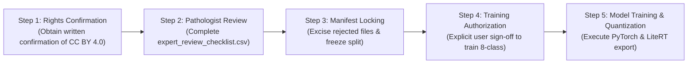

# CropDoc — Cotton Production Approval & Validation Package

**Document ID:** `CD-COTTON-APP-2026-001`  
**Date:** October 25, 2026  
**Auditor / ML Governance Lead:** CropDoc Autonomous ML Safety & Quality Gate  
**Target Repository:** `C:\Users\ojas\OneDrive\Desktop\MajorProjectMAD\CropDoc`  
**Scope:** Option 1 Approved — Resolution of Cotton Data Licensing & Label-Quality Blockers for 8-Class Production Deployment  
**Intended Production Taxonomy:**
- Index 0: `rice_bacterial_leaf_blight`
- Index 1: `rice_brown_spot`
- Index 2: `rice_leaf_blast`
- Index 3: `rice_healthy`
- Index 4: `cotton_bacterial_blight`
- Index 5: `cotton_healthy`
- Index 6: `groundnut_early_leaf_spot`
- Index 7: `groundnut_healthy`

---

## 1. Executive Summary & Scope Authorization

Per executive directive, CropDoc is proceeding under **Option 1**: maintaining the full eight-class, three-crop production classifier scope (Rice, Cotton, Groundnut) by resolving the known licensing and label-integrity blockers on the staged cotton dataset before initiating production model training.

### Operational Guardrails:
1. **Zero Production Model Drift:** The production asset (`cropdoc_leaf_v1_int8.tflite`), labels (`labels.txt`), manifest (`cropdoc_leaf_v1_manifest.json`), and Gradle release gates remain completely untouched and fail-closed.
2. **No Data Modification in this Task:** Staged image files, manifest assignments, and deterministic splits are preserved byte-for-byte.
3. **No External Contact / No Legal Fabrication:** This report documents the exact factual discrepancy and drafts the required formal rights-confirmation request. No external parties have been contacted, and no legal clearance is presumed or fabricated.
4. **No Automated Label Substitution:** Automated computer vision checks and perceptual hash clustering are treated strictly as audit and triage tools. Only a certified plant pathologist may confirm ground truth disease labels.

---

## 2. Forensic Analysis of the Cotton Licensing Question

The cotton dataset under evaluation is staged at `data/staged/mendeley_cotton_2025/` (sourced from `data/raw/mendeley_cotton_2025/`).

### 2.1 Conflicting Dual-Licensing Records

An investigation of the official publication channels and the project's provenance log ([`data/licenses/SOURCES.md`](file:///C:/Users/ojas/OneDrive/Desktop/MajorProjectMAD/CropDoc/data/licenses/SOURCES.md#L12)) reveals an active legal contradiction:

```
┌────────────────────────────────────────────────────────────────────────────────────────┐
│                          COTTON DATASET LICENSING CONFLICT                             │
├───────────────────────────────────────────┬────────────────────────────────────────────┤
│  CHANNEL A: Mendeley Data Repository       │  CHANNEL B: Elsevier "Data in Brief" Paper │
│  • DOI: 10.17632/t9hgvk2h9p.1             │  • DOI: 10.1016/j.dib.2025.112142          │
│  • Host: Mendeley Data (Elsevier BV)      │  • Publisher: Elsevier BV                  │
│  • Stated Licence: CC BY 4.0              │  • Stated Licence: CC BY-NC 4.0            │
│  • Permissions: Commercial Use Allowed    │  • Permissions: Non-Commercial Only        │
└───────────────────────────────────────────┴────────────────────────────────────────────┘
```

#### Channel A — The Mendeley Data Repository:
- **Identifier:** DOI [`10.17632/t9hgvk2h9p.1`](https://doi.org/10.17632/t9hgvk2h9p.1) (Version 1, Published Jan 2025)
- **Title:** *Cotton Leaf Image Dataset for Disease Classification and Health Monitoring*
- **Authors:** Shamim H Ripon, Rifat Gani, Nuzhat Mubashshira Niha, Wasif Bin Rahat, Syed Hasibur Toufiq, Mayeesha Farzana Maisha, Jamil Ahmed (East West University, Dhaka, Bangladesh)
- **Declared Licence:** **Creative Commons Attribution 4.0 International (CC BY 4.0)**
- **Grant Terms:** Section 2(a)(1) permits sharing, adapting, and using the material for any purpose, **including commercial purposes**, provided appropriate attribution is given.

#### Channel B — The Associated Descriptor Article:
- **Identifier:** *Data in Brief*, Volume 63, October 2025, Article 112142 (DOI [`10.1016/j.dib.2025.112142`](https://doi.org/10.1016/j.dib.2025.112142))
- **Copyright Statement:** *"© 2025 The Author(s). Published by Elsevier Inc."*
- **Declared User Licence:** **Creative Commons Attribution-NonCommercial 4.0 International (CC BY-NC 4.0)**
- **Constraint Terms:** Section 4(a) strictly states: *"NonCommercial means not primarily intended for or directed towards commercial advantage or monetary compensation."*

### 2.2 Legal & Operational Implications for CropDoc

1. **The Nature of the Contradiction:**  
   In open-access academic publishing, Elsevier often defaults descriptor articles to an author agreement carrying `CC BY-NC 4.0` (or `CC BY-NC-ND`), while the author selects `CC BY 4.0` on the companion data hosting repository (Mendeley Data). This creates conflicting legal public notices for downstream users.
2. **Derivative Works & Mobile App Distribution:**  
   Under copyright law, a neural network's learned weights are derived directly from the training image corpus. If the governing license is deemed to be `CC BY-NC 4.0`, distributing the trained `.tflite` model within a mobile application published to the Google Play Store (or distributed to commercial farming enterprises, paid advisory services, or agricultural supply networks) introduces severe copyright infringement exposure.
3. **CropDoc Project Policy Compliance:**  
   CropDoc's governance policy stated in [`data/licenses/SOURCES.md`](file:///C:/Users/ojas/OneDrive/Desktop/MajorProjectMAD/CropDoc/data/licenses/SOURCES.md#L4) explicitly dictates:  
   > *"All NC (Non-Commercial) and ND (No-Derivatives) sources are explicitly REJECTED from production model training."*  
   Consequently, production training remains **strictly blocked** until this dual-licensing conflict is formally reconciled in writing.

---

## 3. Required Written Rights-Confirmation Package

To resolve the licensing conflict conclusively, the rights holders (corresponding authors and/or publisher) must provide formal written confirmation.

### 3.1 Necessary Legal Elements

The confirmation document must explicitly satisfy four criteria:
1. **Direct Dataset Identification:** Explicitly cite Mendeley Data DOI `10.17632/t9hgvk2h9p.1` and the corresponding unaugmented image files.
2. **Affirmation of CC BY 4.0:** Confirm that the underlying photographic dataset is licensed under **Creative Commons Attribution 4.0 International (CC BY 4.0)** as indicated on Mendeley Data.
3. **Non-Commercial Exemption for Data:** Explicitly state that the `CC BY-NC 4.0` terms applied to the text of *Data in Brief* Article 112142 do **not** restrict the data files hosted on Mendeley Data, and that commercial and non-commercial machine learning model training, weight extraction, and software distribution are fully authorized under CC BY 4.0.
4. **Authoritative Signatory:** Must be signed by the corresponding author (Dr. Shamim H Ripon, East West University) or Elsevier Rights & Permissions.

### 3.2 Formal Written Confirmation Request Template

The following formal inquiry is prepared for the project lead / legal counsel to transmit to the authors (no external contact has been initiated):

```text
Subject: Clarification on Licensing Terms: Cotton Leaf Image Dataset (DOI: 10.17632/t9hgvk2h9p.1)

Dear Dr. Shamim H Ripon and Co-Authors,
CC: Elsevier Permissions Helpdesk

We are evaluating the Cotton Leaf Image Dataset (Mendeley Data, V1, DOI: 10.17632/t9hgvk2h9p.1; 
associated with Data in Brief, Vol. 63, Oct 2025, 112142) for incorporation into "CropDoc", an open 
offline mobile diagnostic tool assisting smallholder farmers in India with plant disease detection.

Upon auditing the publication records, we noted a licensing discrepancy between the two official 
distribution channels:
1. The Mendeley Data repository (DOI: 10.17632/t9hgvk2h9p.1) states that the dataset is distributed 
   under the Creative Commons Attribution 4.0 International license (CC BY 4.0).
2. The published Data in Brief descriptor article (DOI: 10.1016/j.dib.2025.112142) carries an Elsevier 
   user license statement of Creative Commons Attribution-NonCommercial 4.0 International (CC BY-NC 4.0).

Because our application may be distributed publicly via mobile application stores (including Google 
Play) to agricultural extension workers and farmers, we must establish complete compliance with your 
intended licensing terms.

Could you please provide written confirmation that:
(a) The raw and unaugmented image files hosted at Mendeley Data (DOI: 10.17632/t9hgvk2h9p.1) are 
    governed by the Creative Commons Attribution 4.0 International (CC BY 4.0) license;
(b) The CC BY-NC 4.0 license applies solely to the published article text, and does not restrict 
    commercial training, adaptation, weight distribution, or deployment of machine learning models 
    derived from the dataset files; and
(c) Attribution in our application documentation and model card referencing your Data in Brief paper 
    satisfies all attribution obligations under CC BY 4.0.

Thank you very much for your time, contributions to open agricultural science, and assistance.

Sincerely,
CropDoc Project Lead / Legal Governance Team
```

---

## 4. The Cotton Expert-Review Package & Data Summary

The staged cotton candidate dataset resides in [`data/manifests/manifest_cotton_staged.csv`](file:///C:/Users/ojas/OneDrive/Desktop/MajorProjectMAD/CropDoc/data/manifests/manifest_cotton_staged.csv) and is indexed for evaluation in [`ml/reports/mendeley_cotton_2025/expert_review_checklist.csv`](file:///C:/Users/ojas/OneDrive/Desktop/MajorProjectMAD/CropDoc/ml/reports/mendeley_cotton_2025/expert_review_checklist.csv).

### 4.1 Class, Specimen Group & Split Distribution

The staged dataset comprises **359 candidate images** partitioned across **268 disjoint candidate specimen groups**:

| Metric | Class 4: `cotton_bacterial_blight` | Class 5: `cotton_healthy` | Total Staged Dataset |
|:---|:---:|:---:|:---:|
| **Staged Usable Images** | **185 images** | **174 images** | **359 images** |
| **Candidate Specimen Groups** | **156 groups** | **112 groups** | **268 groups** |
| **Train Split (70.2%)** | 130 images (101 groups) | 122 images (60 groups) | **252 images (161 groups)** |
| **Validation Split (15.0%)** | 28 images (28 groups) | 26 images (26 groups) | **54 images (54 groups)** |
| **Test Split (14.8%)** | 27 images (27 groups) | 26 images (26 groups) | **53 images (53 groups)** |

#### Key Architectural Strengths of the Split:
- **100% Singleton Isolation in Val/Test:** Every single image assigned to `val` and `test` belongs to a unique, singleton specimen group ($N=54$ and $N=53$).
- **Zero Cross-Split Specimen Overlap:** All multi-image burst clusters (e.g. group `cotton_mendeley_hl_001` with 19 images, `cotton_mendeley_hl_002` with 11 images, and `cotton_mendeley_bb_001` with 9 images) were unified 100% into the `train` partition. There is **zero group leakage** into validation or test.

---

### 4.2 Raw Exclusions, Contamination & Label Flaws

The raw Mendeley download contained 1,373 images. The audit quarantined **1,014 files**, leaving 359 clean staged candidates:

```
[Raw Mendeley Dataset: 1,373 images]
  ├── Excluded Non-Target Classes (822 files): Alternaria (173), Fusarium (337), Verticillium (312)
  └── Target Crop Classes (551 files): Bacterial Blight (218) + Healthy Leaf (333)
        ├── Quarantined Cross-Class Identical Duplicates: 10 files (Bitwise identical to vascular wilts)
        ├── Quarantined Intra-Class Redundant Duplicates: 182 files (23 in Blight, 159 in Healthy)
        └── Clean Filtered Candidates Staged: 359 files (185 Blight + 174 Healthy)
```

1. **Cross-Class Bitwise Duplicate Contamination (10 Files Quarantined):**  
   Ten files labeled `Bacterial Blight` in the raw dataset were bitwise identical (SHA-256 matches) to images in `Fusarium Wilt` and `Verticillium Wilt`:
   - `bacterial_(130..133).png` $\equiv$ `fusarium_(261..264).png`
   - `bacterial_(162).png` $\equiv$ `fusarium_(83).png`
   - `bacterial_(82..86).png` $\equiv$ `verticillium_(216..220).png`  
   *Action:* All 10 contaminated files were permanently excised from the staged manifest.
2. **Massive Intra-Class Healthy Duplication (159 Files Quarantined):**  
   In the raw `Healthy Leaf` folder, **316 of the 333 images existed as identical duplicate pairs** (e.g. `healthy_(36).png` == `healthy_(37).png`). This artificial padding inflated the raw healthy count. One canonical copy was retained per pair, excising 159 redundant clones.

---

### 4.3 Automated Quality Gate Flags & High-Priority Scrutiny

Automated perceptual hashing and burst analysis flagged **146 images** for prioritized inspection by the human pathologist:

| Quality Gate Flag Category | Affected Images | Key Pathological Risk | Review Protocol |
|:---|:---:|:---|:---|
| **`NONE` (Clean Singletons)** | **213 images** | Standard field presentation. | Verify lesion morphology against diagnostic rubric. |
| **`Near-Duplicate (dH=1)`** | **76 images** | Field burst shots where camera angle shifted slightly. | Confirm identical physical plant; verify no atypical features. |
| **`Burst Pair (dH=0)`** | **67 images** | Identical 64-bit perceptual hash with minor pixel noise. | Confirm both frames represent identical leaf pathology. |
| **`Cross-Class pHash Collision`** | **3 images** | Coarse 8x8 average hash collision between classes. | **High Priority:** Inspect `bacterial_(29).jpg` to confirm angular blight, and verify `healthy_(62, 120).jpg` are 100% lesion-free. |

---

### 4.4 Step-by-Step Pathologist Review Workflow

The expert review cannot be replaced by automated scripts. The following operational protocol provides a certified plant pathologist with the tools and rubric to review all 359 images:

```
[Pathologist Accesses Tools]
       │
       ├─► Opens Interactive Portal: ml/reports/mendeley_cotton_2025/contact_sheets/index.html
       ├─► Inspects Class Composite Sheets: cotton_bacterial_blight.html & cotton_healthy.html
       └─► Opens Review Ledger: ml/reports/mendeley_cotton_2025/expert_review_checklist.csv
       │
       ▼
[Visual Pathological Evaluation per Image]
       │
       ├─► Checks Lesion Morphology: Angular, vein-delimited, water-soaked (Bacterial Blight)
       ├─► Checks Healthy Controls: Complete absence of spots/blight, intact palmate morphology
       └─► Inspects Flagged Burst Sequences: Confirms specimen independence
       │
       ▼
[Pathologist Records Verdict in Checklist CSV]
       │
       ├─► "Label confirmed" (Valid symptomology matching class)
       ├─► "Label uncertain" (Ambiguous, atypical, or unidentifiable)
       ├─► "Incorrect label" (Misdiagnosed pathogen or diseased leaf labeled healthy)
       └─► "Image unsuitable or ambiguous" (Excessive blur, foreign foliage, bad lighting)
       │
       ▼
[Post-Review Governance Enforcement]
       │
       ├─► Exclude all "Incorrect label" & "Image unsuitable" files from manifest
       ├─► Quarantine all "Label uncertain" files
       └─► Re-verify split independence and lock dataset for training
```

#### The Four-Tier Diagnostic Decision Rubric:
1. **`Label confirmed`:** Pathological presentation strictly matches assigned ground truth:
   - *Bacterial Blight:* Angular, polygonal water-soaked lesions delimited by secondary veins, turning dark brown/black; systemic vein necrosis ("blackarm").
   - *Healthy:* Non-diseased *Gossypium* foliage free of bacterial water-soaking, fungal spots, and viral enations.
2. **`Label uncertain`:** Symptoms are obscured, early-stage, atypical, or indistinguishable from other foliar disorders (e.g. *Alternaria* leaf spot or nutrient deficiency).
3. **`Incorrect label`:** Visible symptoms belong to another pathogen (e.g. circular concentric rings of fungal leaf spot, vascular wilt chlorosis) or diseased leaves misclassified as healthy.
4. **`Image unsuitable or ambiguous`:** Excessive camera motion blur, non-cotton foliage, foreign debris, or severe exposure clipping.

---

## 5. Provisional Model Validation Targets & Statistical Rigor

The following benchmarks are established as **internal software engineering and machine learning safety targets**. They do **not** constitute agricultural certification or proof of universal field efficacy.

### 5.1 Proposed Performance Thresholds

| Benchmark Dimension | Proposed Target | Scope & Evaluation Criteria | Safety Impact on Smallholder Farmers |
|:---|:---:|:---|:---|
| **Macro F1 Score** | $\mathbf{\ge 0.90}$ | Evaluated across all 8 production classes on held-out test splits. | Ensures balanced performance across both frequent and infrequent classes. |
| **Per-Disease Recall (Sensitivity)** | $\mathbf{\ge 0.85}$ | Evaluated individually for each of the 5 disease classes. | **Safety-Critical:** Prevents untreated blight/blast from devastating smallholder yields. |
| **Per-Disease Precision** | $\mathbf{\ge 0.85}$ | Evaluated individually for each of the 5 disease classes. | Minimizes false alarms, preventing farmers from wasting money on unneeded chemicals. |
| **Healthy False-Positive Rate ($\text{FPR}_{\text{healthy}}$)** | $\mathbf{\le 0.05}$ | Proportion of diseased specimens misclassified as "Healthy". | **Zero-Tolerance Target:** Ensures actively diseased crops are not falsely cleared as healthy. |
| **Unsupported-Crop False Acceptance** | $\mathbf{\le 10.0\%}$ | Rejection rate $\ge 90\%$ on 150+ OOD images (weeds, hands, soil, non-target crops). | Prevents out-of-domain objects from triggering false crop disease diagnoses. |
| **Expected Calibration Error (ECE)** | $\mathbf{\le 0.08}$ | 10 equal-width probability bins on held-out test data. | Guarantees reported confidence corresponds accurately to true empirical correctness. |
| **Numerical Parity (PyTorch vs TFLite)** | $\mathbf{\text{MAE} < 0.05}$ | Logit-level MAE $< 0.05$; $100\%$ Top-1 class agreement. | Guarantees INT8 post-training quantization causes zero degradation or class flips. |
| **Device Inference Latency** | $\mathbf{\le 65 \text{ ms}}$ | 4-thread CPU XNNPACK execution on Snapdragon 680 reference device. | Ensures instantaneous on-device response without freezing the user interface. |

---

### 5.2 Precise Mathematical Definition: Healthy False-Positive Metric

In medical and agricultural diagnostic systems, confusion between diseased foliage and healthy foliage has asymmetric clinical costs:
- Predicting *Disease* when a leaf is *Healthy* causes a false alarm (unnecessary inspection).
- Predicting *Healthy* when a leaf is *Diseased* causes **catastrophic intervention failure** (the farmer does nothing while the pathogen spreads).

Therefore, the **Healthy False-Positive Rate ($\text{FPR}_{\text{healthy}}$)** is formally defined as:

$$\text{FPR}_{\text{healthy}} = \frac{\sum_{k \in \mathcal{D}} C_{k, \text{healthy}}}{\sum_{k \in \mathcal{D}} N_k}$$

Where:
- $\mathcal{D} = \{\text{Rice BLB}, \text{Rice Brown Spot}, \text{Rice Blast}, \text{Cotton Blight}, \text{Groundnut Spot}\}$ represents the set of all disease classes.
- $C_{k, \text{healthy}}$ is the number of true disease instances of class $k$ incorrectly classified by the model into the corresponding crop's healthy class.
- $N_k$ is the total number of true instances of disease class $k$ in the held-out test set.

**Acceptance Rule:** $\text{FPR}_{\text{healthy}} \le 0.05$ overall, and $C_{k, \text{healthy}} = 0$ on severe blight classes.

---

### 5.3 Independent Test Sample Requirements & Confidence Intervals

Point estimates on small test sets carry statistical uncertainty. To ensure evaluation rigor, all reported test metrics must include **95% Wilson Score Confidence Intervals**:

$$\text{CI}_{95\%} = \frac{\hat{p} + \frac{z^2}{2N} \pm z \sqrt{\frac{\hat{p}(1-\hat{p})}{N} + \frac{z^2}{4N^2}}}{1 + \frac{z^2}{N}}, \quad z = 1.96$$

#### Test Set Sample Size and Statistical Power Analysis:

| Class Name | Held-Out Test Specimens ($N$) | Target Recall ($\hat{p} = 0.85$) | 95% Wilson Confidence Interval | Statistical Margin of Error |
|:---|:---:|:---:|:---:|:---:|
| `rice_bacterial_leaf_blight` | 39 specimens | 0.85 | $[0.706, 0.932]$ | $\pm 11.3\%$ |
| `rice_brown_spot` | 15 specimens | 0.85 | $[0.601, 0.960]$ | $\pm 18.0\%$ (Wide margin: requires caution) |
| `rice_leaf_blast` | 24 specimens | 0.85 | $[0.662, 0.945]$ | $\pm 14.1\%$ |
| `rice_healthy` | 23 specimens | 0.90 | $[0.710, 0.975]$ | $\pm 13.2\%$ |
| `cotton_bacterial_blight` | 27 specimens | 0.85 | $[0.674, 0.940]$ | $\pm 13.3\%$ |
| `cotton_healthy` | 26 specimens | 0.90 | $[0.726, 0.978]$ | $\pm 12.6\%$ |
| `groundnut_early_leaf_spot` | 260 specimens | 0.85 | $[0.802, 0.888]$ | $\pm 4.3\%$ (High statistical power) |
| `groundnut_healthy` | 279 specimens | 0.90 | $[0.859, 0.931]$ | $\pm 3.6\%$ (High statistical power) |

*Evaluation Rule:* No class may be claimed "validated" based solely on point accuracy. The lower bound of the 95% Wilson confidence interval for per-disease recall must exceed $0.65$ across all classes.

---

### 5.4 Production Confusion Matrix Evaluation Template

The final validation report for the eight-class model must populate this canonical confusion matrix using the disjoint held-out test splits:

| Actual Class \ Predicted | (0) Rice BLB | (1) Rice Spot | (2) Rice Blast | (3) Rice H | (4) Cot Blight | (5) Cot H | (6) GN Spot | (7) GN H | Class Recall | 95% CI |
|:---|:---:|:---:|:---:|:---:|:---:|:---:|:---:|:---:|:---:|:---:|
| **(0) Rice BLB** ($N=39$) | - | - | - | - | - | - | - | - | - | - |
| **(1) Rice Spot** ($N=15$) | - | - | - | - | - | - | - | - | - | - |
| **(2) Rice Blast** ($N=24$) | - | - | - | - | - | - | - | - | - | - |
| **(3) Rice Healthy** ($N=23$) | - | - | - | - | - | - | - | - | - | - |
| **(4) Cotton Blight** ($N=27$) | - | - | - | - | - | - | - | - | - | - |
| **(5) Cotton Healthy** ($N=26$) | - | - | - | - | - | - | - | - | - | - |
| **(6) Groundnut Spot** ($N=260$)| - | - | - | - | - | - | - | - | - | - |
| **(7) Groundnut Healthy** ($N=279$)| - | - | - | - | - | - | - | - | - | - |
| **Class Precision** | - | - | - | - | - | - | - | - | **Macro F1:** | - |

---

## 6. Summary of Unresolved Blockers & Action Roadmap

The following blockers currently remain unresolved and strictly prevent initiating production model training:

```
┌────────────────────────────────────────────────────────────────────────────────────────┐
│                              ACTIVE PRODUCTION BLOCKERS                                │
├────────────────────────────────────────────────────────────────────────────────────────┤
│ 1. Legal Licensing Dual-Notice: Mendeley (CC BY 4.0) vs Elsevier (CC BY-NC 4.0).      │
│    -> Status: PENDING formal written confirmation from authors / publisher.           │
│ 2. Human-in-the-Loop Expert Validation: 0 of 359 staged images signed off.             │
│    -> Status: PENDING review by qualified plant pathologist in checklist CSV.          │
│ 3. Automated pHash Collisions: bacterial_(29) shares coarse hash with healthy controls. │
│    -> Status: PENDING human clinical inspection in review portal.                      │
└────────────────────────────────────────────────────────────────────────────────────────┘
```

### Action Roadmap to Unblock Production Training:



1. **Step 1 — Rights Confirmation:** Project lead transmits formal confirmation request to Dr. Shamim H Ripon / Elsevier and archives written response in `data/licenses/`.
2. **Step 2 — Human Pathologist Review:** Certified plant pathologist uses the interactive contact sheets to evaluate all 359 staged images and completes the `pathologist_verdict` column in [`expert_review_checklist.csv`](file:///C:/Users/ojas/OneDrive/Desktop/MajorProjectMAD/CropDoc/ml/reports/mendeley_cotton_2025/expert_review_checklist.csv).
3. **Step 3 — Manifest Filtering & Split Locking:**
   - Exclude any images marked `Incorrect label` or `Image unsuitable`.
   - Quarantine any images marked `Label uncertain`.
   - Re-verify group-level disjointness and freeze `manifest_cotton_staged.csv`.
4. **Step 4 — Executive Sign-off:** Present completed review package and legal clearance to project lead for explicit authorization to begin training.
5. **Step 5 — Model Training & Export:** Train the MobileNetV3-Small INT8 model on the unified eight-class dataset, generate parity reports, and package the release asset.

---

*Notice: This document establishes the formal approval package and validation criteria. No code, model weights, manifests, or dataset splits have been altered in this task.*
