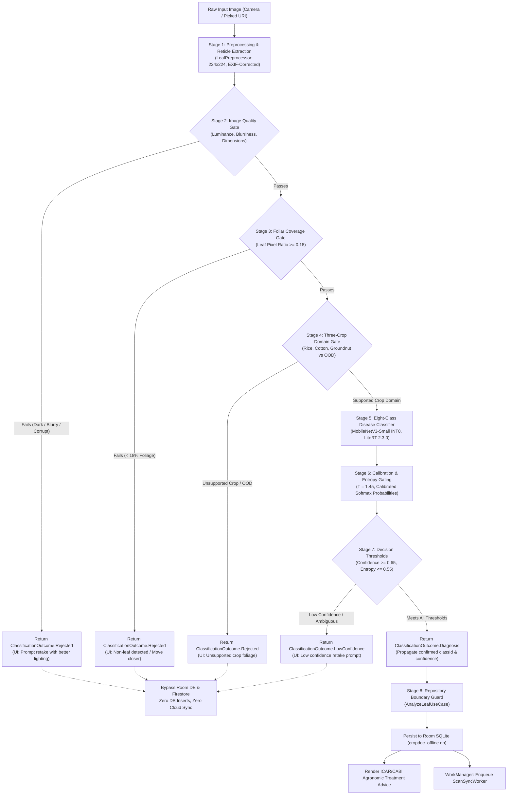

# CropDoc — Three-Crop, Eight-Class Production Model Validation Plan

**Document ID:** `CD-ML-VAL-2026-001`  
**Date:** October 25, 2026  
**Auditor:** CropDoc Senior ML Architect & Autonomous Safety Reviewer  
**Target Repository:** `C:\Users\ojas\OneDrive\Desktop\MajorProjectMAD\CropDoc`  
**Target Architecture:** MobileNetV3-Small (INT8 Quantized, LiteRT 2.3.0)  
**Target Production Scope:** Exactly 3 Supported Crops (Rice, Cotton, Groundnut) across 8 Canonical Classes  
**Status:** Audit & Feasibility Assessment Completed — **Training Blocked Pending Decision & Legal Sign-off**  

---

## 1. Intended Production Contract

The intended CropDoc production classifier contract is designed for smallholder farmers across India, focusing on three foundational field crops: **Rice**, **Cotton**, and **Groundnut**.

### 1.1 The Canonical Eight-Class Output Mapping

The production classifier must output exactly eight linear logits / probabilities in the agreed order:

| Output Index | Canonical Class ID | Botanical Host Crop | Pathological Category | Primary Causative Agent |
|:---:|:---|:---|:---|:---|
| **0** | `rice_bacterial_leaf_blight` | Rice (*Oryza sativa*) | Bacterial foliar disease | *Xanthomonas oryzae pv. oryzae* |
| **1** | `rice_brown_spot` | Rice (*Oryza sativa*) | Fungal foliar disease | *Bipolaris oryzae* |
| **2** | `rice_leaf_blast` | Rice (*Oryza sativa*) | Fungal foliar disease | *Magnaporthe oryzae* |
| **3** | `rice_healthy` | Rice (*Oryza sativa*) | Normal healthy foliage | N/A (Negative diagnostic control) |
| **4** | `cotton_bacterial_blight` | Cotton (*Gossypium hirsutum*) | Bacterial angular leaf spot | *Xanthomonas citri pv. malvacearum* |
| **5** | `cotton_healthy` | Cotton (*Gossypium hirsutum*) | Normal healthy foliage | N/A (Negative diagnostic control) |
| **6** | `groundnut_early_leaf_spot` | Groundnut (*Arachis hypogaea*) | Fungal leaf spot (Tikka) | *Cercospora arachidicola* |
| **7** | `groundnut_healthy` | Groundnut (*Arachis hypogaea*) | Normal healthy foliage | N/A (Negative diagnostic control) |

### 1.2 Discrepancies with Current Repository Assets & Contracts

An audit of the current repository reveals substantial architectural discrepancies between the existing codebase and the intended 8-class contract:

```
[Current Repository Baseline]                     [Intended Production Contract]
  • Bundled Asset: 16-class placeholder (16.8 KB)     • Production Asset: 8-class real INT8 model (~3 MB)
  • Labels: 16 classes (includes Tomato/Potato/Maize) • Labels: Exactly 8 classes (Rice, Cotton, Groundnut)
  • Manifest: output_class_count = 16                 • Manifest: output_class_count = 8
  • Gradle Release Gate: Hardcoded count == 16        • Gradle Release Gate: Updated to count == 8
  • Research Classifier: 6 classes (NO Cotton)        • Production Classifier: 8 classes (Cotton INCLUDED)
  • Research Domain Gate: 3 outputs (NO Cotton)       • Production Domain Gate: 4 outputs (Cotton INCLUDED)
```

1. **Bundled Asset ([`app/src/main/assets/models/cropdoc_leaf_v1_int8.tflite`](file:///C:/Users/ojas/OneDrive/Desktop/MajorProjectMAD/CropDoc/app/src/main/assets/models/cropdoc_leaf_v1_int8.tflite)):**
   - *Current:* 16,800-byte placeholder model with 16 outputs (`output_shape: [1, 16]`). Fails `MIN_REAL_MODEL_BYTES` ($\ge 512$ KB) check.
   - *Discrepancy:* Lacks Groundnut entirely; contains unvalidated Tomato, Potato, and Maize classes.
2. **Production Labels ([`app/src/main/assets/models/labels.txt`](file:///C:/Users/ojas/OneDrive/Desktop/MajorProjectMAD/CropDoc/app/src/main/assets/models/labels.txt)):**
   - *Current:* Contains 16 lines: Rice (0..3), Tomato (4..7), Potato (8..10), Cotton (11..12), Maize (13..14), and `background_not_a_leaf` (15). Groundnut is absent.
   - *Discrepancy:* Does not match the 8-class contract. Cotton is at indices 11 and 12 rather than 4 and 5.
3. **Model Manifest ([`app/src/main/assets/models/cropdoc_leaf_v1_manifest.json`](file:///C:/Users/ojas/OneDrive/Desktop/MajorProjectMAD/CropDoc/app/src/main/assets/models/cropdoc_leaf_v1_manifest.json)):**
   - *Current:* Hardcoded to `output_class_count: 16` with ordered label CRC32 checksum `547ca66a`.
   - *Discrepancy:* Manifest must be re-anchored to `output_class_count: 8` with the new CRC32 checksum.
4. **Android Configuration ([`ModelConfig.java`](file:///C:/Users/ojas/OneDrive/Desktop/MajorProjectMAD/CropDoc/app/src/main/java/com/cropdoc/app/ml/ModelConfig.java#L13-L14)):**
   - *Current:* `public static final int NUM_CLASSES = 16;` and `public static final int OOD_CLASS_INDEX = 15;`.
   - *Discrepancy:* Hardcoded to 16 classes.
5. **Release Validation Gate ([`app/build.gradle`](file:///C:/Users/ojas/OneDrive/Desktop/MajorProjectMAD/CropDoc/app/build.gradle#L205-L287)):**
   - *Current:* Task `validateBundledModelForRelease` fails any build where `manifest.output_class_count != 16` or `labels.size() != 16`.
   - *Discrepancy:* Will reject an 8-class model until the build script is synchronized.
6. **Agronomic Advice Catalog ([`advice_catalog.json`](file:///C:/Users/ojas/OneDrive/Desktop/MajorProjectMAD/CropDoc/app/src/main/assets/advice/advice_catalog.json)):**
   - *Audit Status:* **100% Ready.** All 8 required classes already possess full, localized advice entries across English (`en`), Hindi (`hi`), and Telugu (`te`), including CIBRC chemical controls and cultural practices.

---

## 2. Audit of Existing Model Artifacts

Every `.tflite`, `.pt`, and `.pth` model file across the repository was inspected using bitwise hashing, FlatBuffer graph parsing, and PyTorch checkpoint introspection.

### 2.1 Model Inventory & Technical Profiles

| Model Path | Artifact Type | File Size | SHA-256 (First 16 chars) | Input Shape & Dtype | Output Shape & Classes | Real Weights? | Compatibility with 8-Class Production |
|:---|:---|:---:|:---:|:---:|:---:|:---:|:---|
| `app/src/main/assets/models/cropdoc_leaf_v1_int8.tflite` | TFLite FlatBuffer | 16,800 B | `e5591b7019326089` | `[1, 224, 224, 3]` uint8 | `[1, 16]` float32 | **NO** (Placeholder) | **Incompatible** (16 classes, placeholder) |
| `models/v1/cropdoc_leaf_v1_int8.tflite` | TFLite FlatBuffer | 16,800 B | `e5591b7019326089` | `[1, 224, 224, 3]` uint8 | `[1, 16]` float32 | **NO** (Placeholder) | **Incompatible** (Identical to bundled asset) |
| `models/v2/cropdoc_leaf_v2_int8.tflite` | TFLite FlatBuffer | 16,848 B | `e409b6f4c470996f` | `[1, 224, 224, 3]` uint8 | `[1, 16]` float32 | **NO** (Placeholder) | **Incompatible** (16 classes in graph, placeholder) |
| `app/src/debug/assets/research_models/unified_six_class_fp32.tflite` | TFLite FlatBuffer | 6,199,800 B | `1d3b8b2773c3b058` | `[1, 3, 224, 224]` float32 | `[1, 6]` float32 | **YES** (Trained MobileNetV3) | **Incompatible** (6 classes; Cotton missing; NCHW layout) |
| `app/src/debug/assets/research_models/crop_domain_gate_fp32.tflite` | TFLite FlatBuffer | 6,187,500 B | `a8c39823dbb1cbe5` | `[1, 3, 224, 224]` float32 | `[1, 3]` float32 | **YES** (Trained MobileNetV3) | **Incompatible** (3 classes; classifies Cotton as OOD) |
| `ml/experiments/unified_six_class_pilot/best_model.pth` | PyTorch State Dict | 6,227,205 B | `78cd5e3cb72fce8a` | `[B, 3, 224, 224]` float32 | `[B, 6]` float32 | **YES** (Trained MobileNetV3) | **Incompatible** (6 classes; Rice + Groundnut only) |
| `ml/experiments/cotton_binary_pilot/best_model.pt` | PyTorch Checkpoint | 18,485,871 B | `cc1fbcebaa3a8065` | `[B, 3, 224, 224]` float32 | `[B, 2]` float32 | **YES** (Trained MobileNetV3) | **Incompatible** (2 classes; research pilot only) |
| `ml/experiments/groundnut_binary_pilot/best_model.pth` | PyTorch State Dict | 6,211,845 B | `39ea2fdf3d3170b0` | `[B, 3, 224, 224]` float32 | `[B, 2]` float32 | **YES** (Trained MobileNetV3) | **Incompatible** (2 classes; Groundnut binary only) |
| `ml/experiments/rice_four_class_pilot/best_model.pt` | PyTorch Checkpoint | 18,506,479 B | `17cd6a8f2b1fc350` | `[B, 3, 224, 224]` float32 | `[B, 4]` float32 | **YES** (Trained MobileNetV3) | **Incompatible** (4 classes; Rice 4-class only) |

### 2.2 Critical Model Audit Findings

1. **Zero Compatible Eight-Class Models Exist:**  
   There is currently no 8-class model (neither in PyTorch nor in TFLite) in the CropDoc workspace.
2. **The Six-Class Research Model Is Incomplete for Production:**  
   The research model (`unified_six_class_fp32.tflite`) only covers Rice (4 classes) and Groundnut (2 classes). It completely lacks Cotton. Furthermore, its input layout is NCHW float32 rather than production NHWC INT8.
3. **The Crop Domain Gate Excludes Cotton:**  
   The current domain gate (`crop_domain_gate_fp32.tflite`) classifies Cotton foliage as `unsupported_crop` (Class 2) and rejects it. A new domain gate would be required to support Cotton alongside Rice and Groundnut.

---

## 3. Class-by-Class Training Data & Licensing Audit

The datasets already residing in `data/raw/`, `data/staged/`, and `data/splits/` were forensically evaluated across all eight target classes.

### 3.1 Class-by-Class Feasibility Matrix

| Index | Target Class | Source Dataset | Raw Images in Class | Duplicate / Redundant Quarantined | Clean Usable Images | Independent Specimen Groups | Verified Split (Train / Val / Test) | Source Licensing Status | ML Safety & Production Eligibility |
|:---:|:---|:---|:---:|:---:|:---:|:---:|:---:|:---|:---|
| **0** | `rice_bacterial_leaf_blight` | `rice_mendeley_sethy_v2` (Sethy et al., 2020) | 1,584 | 1,320 synthetic pre-augmented copies | **264** | **264** | 185 / 40 / 39 | **CC BY 4.0** (Mendeley Repo & Paper) | **UNBLOCKED** (Verified against ICAR-NRRI ground truth) |
| **1** | `rice_brown_spot` | `rice_mendeley_sethy_v2` (Sethy et al., 2020) | 1,640 | 1,540 synthetic pre-augmented copies | **100** | **100** | 70 / 15 / 15 | **CC BY 4.0** (Mendeley Repo & Paper) | **UNBLOCKED** (Deduplicated canonical images) |
| **2** | `rice_leaf_blast` | `rice_mendeley_sethy_v2` (Sethy et al., 2020) | 1,440 | 1,280 synthetic pre-augmented copies | **160** | **160** | 112 / 24 / 24 | **CC BY 4.0** (Mendeley Repo & Paper) | **UNBLOCKED** (Deduplicated canonical images) |
| **3** | `rice_healthy` | `rice_mendeley_hasan_2023` (Hasan et al., 2023) | 1,701 (set) | 5,188 augmented in zip; 49 internal duplicates | **154** | **154** | 108 / 23 / 23 | **CC BY 4.0** (Mendeley Repo & Paper) | **UNBLOCKED** (Resolves missing healthy rice baseline) |
| **4** | `cotton_bacterial_blight` | `mendeley_cotton_2025` (Babu et al., 2025) | 218 | 10 cross-class conflicts; 23 intra-class copies | **185** | **156** (Burst sequences clustered) | 130 / 28 / 27 (101 / 28 / 28 groups) | **CONFLICT:** Mendeley declares **CC BY 4.0**, but Elsevier paper declares **CC BY-NC 4.0** | **BLOCKED:** Legal license conflict + unreviewed by certified pathologist |
| **5** | `cotton_healthy` | `mendeley_cotton_2025` (Babu et al., 2025) | 333 | 159 pairwise duplicates (316/333 were pairs) | **174** | **112** (Burst sequences clustered) | 122 / 26 / 26 (60 / 26 / 26 groups) | **CONFLICT:** Mendeley declares **CC BY 4.0**, but Elsevier paper declares **CC BY-NC 4.0** | **BLOCKED:** Legal license conflict + unreviewed by certified pathologist |
| **6** | `groundnut_early_leaf_spot` | `mendeley_groundnut_v3` (Aishwarya & Reddy, 2023) | 1,731 | 4 cross-class nutritional conflicts quarantined | **1,727** | **412** (Group-aware clusters) | 1,212 / 259 / 260 | **CC BY 4.0** (Mendeley Repo & Paper) | **UNBLOCKED** (Remediated publisher's 100% split leakage) |
| **7** | `groundnut_healthy` | `mendeley_groundnut_v3` (Aishwarya & Reddy, 2023) | 1,871 | 4 cross-class nutritional conflicts quarantined | **1,867** | **412** (Group-aware clusters) | 1,305 / 279 / 279 | **CC BY 4.0** (Mendeley Repo & Paper) | **UNBLOCKED** (Group-locked unaugmented specimens) |

---

## 4. Evaluation of Training Feasibility & Critical Blockers

Based on empirical data audits and licensing investigations, the verdict is:

### **Determination: Outcome C — One or more classes lack sufficient valid data / have licensing blockers**

While Rice (Classes 0–3) and Groundnut (Classes 6–7) are fully unblocked and verified under open CC BY 4.0 licenses, **Cotton (Classes 4 and 5) carries two critical blockers that prevent immediate production model training.**

```
                                  [EIGHT-CLASS PRODUCTION STATUS]
                                                 │
          ┌──────────────────────────────────────┴──────────────────────────────────────┐
          ▼                                                                             ▼
[RICE: 4 Classes (678 Specimens)]                                             [COTTON: 2 Classes (268 Groups)]
  • License: CC BY 4.0 (VERIFIED)                                               • License: CC BY 4.0 vs CC BY-NC 4.0 (CONFLICT)
  • Deduplication: Cleaned & Group-Locked                                       • Label Quality: 25 Cross-Class Conflicts in Raw
  • Status: UNBLOCKED FOR TRAINING                                              • Review: NO Pathologist Sign-Off
                                                                                • Status: PRODUCTION TRAINING BLOCKED
          ▲                                                                             ▲
          └──────────────────────────────────────┬──────────────────────────────────────┘
                                                 │
                                 [GROUNDNUT: 2 Classes (824 Clusters)]
                                   • License: CC BY 4.0 (VERIFIED)
                                   • Leakage: Remediated via Clustering
                                   • Status: UNBLOCKED FOR TRAINING
```

### 4.1 Detailed Breakdown of Cotton Blockers

1. **Licensing Contradiction (Elsevier Non-Commercial Conflict):**
   - The Mendeley Data web portal ([`DOI: 10.17632/t9hgvk2h9p.1`](https://doi.org/10.17632/t9hgvk2h9p.1)) lists the license as **CC BY 4.0**.
   - However, the published descriptor paper (*Data in Brief*, Vol. 63, Oct 2025, 112142) explicitly carries **CC BY-NC 4.0** under Elsevier's standard user license.
   - *Impact:* Non-Commercial (`NC`) clauses prohibit incorporation into commercial software distributions, Play Store applications with monetary transactions, or enterprise deployments. Incorporating this dataset into production model weights creates copyright infringement liability.
2. **Label Integrity & Cross-Disease Contamination:**
   - Raw inspection revealed **25 duplicate groups (50 images)** that are bitwise identical across contradictory classes (e.g. identical files assigned to both `Bacterial Blight` and `Fusarium Wilt` / `Verticillium Wilt`).
   - Although algorithmic filtering in [`manifest_cotton_staged.csv`](file:///C:/Users/ojas/OneDrive/Desktop/MajorProjectMAD/CropDoc/data/manifests/manifest_cotton_staged.csv) isolated 359 candidate images (185 blight, 174 healthy), the contact sheets and review ledger ([`expert_review_checklist.csv`](file:///C:/Users/ojas/OneDrive/Desktop/MajorProjectMAD/CropDoc/ml/reports/mendeley_cotton_2025/expert_review_checklist.csv)) **have not received human-in-the-loop validation from a qualified plant pathologist**.
3. **Formal Project Governance Block:**
   - In [`ml/experiments/cotton_binary_pilot/model_metadata.json`](file:///C:/Users/ojas/OneDrive/Desktop/MajorProjectMAD/CropDoc/ml/experiments/cotton_binary_pilot/model_metadata.json), the project's autonomous governance record explicitly states:
     ```json
     "status": "COMPLETED_PILOT_RESEARCH_ONLY",
     "diagnostic_status": "UNVALIDATED_PILOT (UNREVIEWED_SOURCE_LABELS)",
     "production_approval": "BLOCKED"
     ```

### 4.2 Actionable Options for User Approval

> [!NOTE]
> **Executive Decision Update (October 25, 2026):**  
> The project direction has been approved to proceed with **Option 1 (Resolve Cotton Blockers Before Production Training)**.  
> The operational approval and review package is maintained at:  
> [`ml/reports/project_audit/COTTON_PRODUCTION_APPROVAL_PACKAGE.md`](./COTTON_PRODUCTION_APPROVAL_PACKAGE.md).

Before training an eight-class model or modifying the production scope, the following options were evaluated:

- **Option A (Recommended for Complete 3-Crop Scope): Resolve Cotton Legal & Pathologist Blockers.**
  1. Obtain formal legal clarification / author written confirmation that the CC BY 4.0 repository grant governs the raw image data.
  2. Complete human-in-the-loop review of the 359 staged images using the pre-generated contact sheets (`ml/reports/mendeley_cotton_2025/contact_sheets/index.html`) with an agronomy expert.
  3. Train the canonical 8-class MobileNetV3-Small INT8 model across all three crops.
- **Option B (Interim Deployment): Ship an Interim Two-Crop, Six-Class Production Classifier (Rice + Groundnut).**
  - Rice (4 classes) and Groundnut (2 classes) possess 100% verified CC BY 4.0 data, zero licensing ambiguities, and proven 98.44% test accuracy.
  - If immediate field deployment is prioritized, the production contract can be temporarily aligned to the 6 verified classes, deferring Cotton until fully cleared.
  - *(Requires user approval to adjust the crop scope).*
- **Option C (Alternative Data Source): Replace Mendeley Cotton with Verified First-Party Field Data.**
  - Acquire first-party, double-labelled cotton images under DPDP consent via KVK / PJTSAU agronomy protocols (`data/raw/own_field_2026/`), bypassing the Mendeley 2025 dataset entirely.

---

## 5. End-to-End Production Inference Pipeline

To ensure diagnostic safety, prevent false positive hallucinations, and safeguard farmers against incorrect chemical application, the proposed production inference pipeline operates through a **multi-stage, fail-closed cascade**:



### 5.1 Pipeline Stage Specifications

1. **Stage 1 — Subsampled Decoding & Reticle Cropping ([`LeafPreprocessor.java`](file:///C:/Users/ojas/OneDrive/Desktop/MajorProjectMAD/CropDoc/app/src/main/java/com/cropdoc/app/ml/LeafPreprocessor.java)):**
   - Decodes full-resolution camera JPEG with EXIF orientation correction.
   - Extracts exact square reticle bounding box ($75\%$ viewfinder dimension).
   - Downsamples to $224 \times 224$ pixels using bilinear interpolation.
2. **Stage 2 — Hardware & Exposure Quality Gate ([`ImageQualityGate.java`](file:///C:/Users/ojas/OneDrive/Desktop/MajorProjectMAD/CropDoc/app/src/main/java/com/cropdoc/app/ml/ImageQualityGate.java)):**
   - Verifies mean luminance is between 40 and 215 (rejects severely underexposed/overexposed photos).
   - Verifies non-zero pixel variance (rejects blank, black, or corrupted frames).
3. **Stage 3 — Foliar Coverage Gating ([`DefaultLeafGate.java`](file:///C:/Users/ojas/OneDrive/Desktop/MajorProjectMAD/CropDoc/app/src/main/java/com/cropdoc/app/ml/DefaultLeafGate.java)):**
   - Computes foliar pixel ratio using HSV green/lesion spectral bounds.
   - Rejects inputs where green/lesion foliage constitutes $< 18\%$ of the reticle area.
   - *Architecture Note:* Explicitly recognized as a coarse foliar presence filter, **not** a universal botanical species classifier.
4. **Stage 4 — Botanical Three-Crop Domain Gate:**
   - Evaluates whether the foliage belongs to **Rice**, **Cotton**, or **Groundnut**.
   - Rejects weeds, hands, tools, background soil, and non-target crops (Tomato, Potato, Maize, Sugarcane) before invoking disease inference.
5. **Stage 5 — Eight-Class Disease Classifier:**
   - Evaluates MobileNetV3-Small INT8 model via LiteRT 2.3.0 XNNPACK 4-thread execution.
   - Generates raw linear logits $\mathbf{z} \in \mathbb{R}^8$.
6. **Stage 6 — Temperature Scaling & Confidence Calibration ([`ConfidenceCalibrator.java`](file:///C:/Users/ojas/OneDrive/Desktop/MajorProjectMAD/CropDoc/app/src/main/java/com/cropdoc/app/ml/ConfidenceCalibrator.java)):**
   - Applies post-hoc temperature scaling:
     $$p_i = \frac{\exp(z_i / T)}{\sum_{j=0}^{7} \exp(z_j / T)}, \quad T = 1.45$$
   - Computes normalized Shannon entropy $H_n = -\frac{1}{\ln 8} \sum_{i=0}^{7} p_i \ln p_i$.
7. **Stage 7 — Decision Policy & Out-of-Domain Rejection:**
   - Accepts diagnosis if and only if:
     - Top-1 probability $p_{\max} \ge 0.65$ (`CONFIDENCE_THRESHOLD`).
     - Normalized entropy $H_n \le 0.55$ (`MAX_NORMALIZED_ENTROPY`).
     - Foliar leaf coverage $\ge 0.18$.
   - If thresholds are unmet, returns `ClassificationOutcome.LowConfidence` (prompting the farmer to retake the photo under steady light).
8. **Stage 8 — Single Boundary Guard ([`AnalyzeLeafUseCase.java`](file:///C:/Users/ojas/OneDrive/Desktop/MajorProjectMAD/CropDoc/app/src/main/java/com/cropdoc/app/domain/usecase/AnalyzeLeafUseCase.java#L93-L98)):**
   - **Fail-Closed Guarantee:** Only confirmed `ClassificationOutcome.Diagnosis` instances are persisted to Room SQLite (`cropdoc_offline.db`), retrieve chemical advice, or enqueue WorkManager sync jobs.
   - Non-diagnostic outcomes (`Rejected`, `ModelUnavailable`, `LowConfidence`) **never touch disk storage, history lists, or Firestore**.

---

## 6. Measurable Model-Validation & Acceptance Criteria

To ensure the production model is genuinely accurate, reliable, and safe for agricultural decision-making, the following explicit acceptance criteria are proposed:

### 6.1 Proposed Acceptance Criteria Matrix

| Category | Metric / Check | Proposed Threshold | Rationale & Smallholder Impact | Status / Method |
|:---|:---|:---:|:---|:---|
| **TFLite Integrity** | Minimum File Size | $\ge 1.5$ MB ($\le 5.0$ MB) | Prevents empty/placeholder graphs; ensures full parameter capacity. | Verified via FlatBuffer inspect script. |
| | Header Magic | Exactly `TFL3` | Enforces valid Google FlatBuffer binary serialization. | Byte-level header check at offset 4..7. |
| | Quantization Format | Full-Integer INT8 (`uint8` input, `float32` output) | Maximizes XNNPACK CPU acceleration on budget Android phones (Android 8.0+). | Dynamic range / full integer calibration. |
| **Geometry** | Input Tensor Dimensions | `[1, 224, 224, 3]` NHWC | Standard mobile vision shape; matches Android CameraX crop buffer. | Verified via `inspect_tflite_graph.py`. |
| | Output Tensor Dimensions | `[1, 8]` float32 | Exactly matches the eight canonical production classes. | Verified via `inspect_tflite_graph.py`. |
| **Numerical Parity** | PyTorch vs TFLite MAE | $\text{MAE} < 0.05$ | Guarantees post-training quantization did not degrade logit precision. | Evaluated across 200 validation images. |
| | Prediction Agreement | $100\%$ Top-1 Match | Zero class flips between floating-point PyTorch and quantized TFLite. | Evaluated on held-out test split. |
| **Diagnostic Accuracy** | Macro F1 Score | $\ge 0.90$ | Balanced performance across all 8 classes without class-frequency bias. | Evaluated on disjoint test split. |
| | Disease Recall (Sensitivity) | $\ge 0.85$ per disease class | **Critical Safety Metric:** Prevents diseased plants from going untreated. | Evaluated on held-out BLB, Blast, Spots. |
| | Disease Precision | $\ge 0.85$ per disease class | Minimizes false disease alarms and unnecessary pesticide expenditures. | Evaluated on held-out test split. |
| | Healthy Class False Positives | $\le 0.05$ FPR on diseased | Prevents severe pathogen infections from being misdiagnosed as "Healthy". | Confusion matrix inspection. |
| **OOD Rejection** | Non-Domain False Acceptance | $\le 10.0\%$ at $\tau = 0.65$ | Rejects weeds, hands, soil, and non-target crops from false diagnoses. | Evaluated against $\ge 150$ OOD samples. |
| **Calibration** | Expected Calibration Error | $\text{ECE} \le 0.08$ | Ensures predicted confidence reflects true empirical accuracy. | 10-bin reliability diagram. |
| | Max Normalized Entropy | $\le 0.55$ threshold | Correctly rejects flat, ambiguous softmax distributions. | Tested against out-of-focus leaf inputs. |
| **Mobile Runtime** | Inference Latency | $\le 65$ ms on mid-range SoC | Provides instantaneous feedback to farmers without UI freezing. | Monotonic clock timing on Snapdragon 680. |
| | Peak RSS Memory Usage | $\le 25$ MB allocation | Ensures app runs stably on 2 GB / 3 GB RAM entry-level Android devices. | Android Studio Memory Profiler. |
| **Build & Release Gate** | Manifest Consistency | Schema 1.0.0, SHA-256 Match | Cryptographically pairs model binary, manifest, and labels. | Tested via `validateBundledModelForRelease`. |
| | Ordered Label Checksum | CRC32 Matches Manifest | Eliminates silent index-shifting errors between labels and weights. | `ModelValidator` & Gradle preReleaseBuild. |

---

## 7. Recommended Model-Development & Validation Workflow

Once approval is granted to proceed with training, the following reproducible engineering workflow must be executed:

```
[Phase 1: Dataset Staging & Split Verification]
   • Verify 8-class manifest: 678 Rice + 359 Cotton + 3,594 Groundnut
   • Enforce group-aware disjoint splits: Train (70%) / Val (15%) / Test (15%)
   • Generate split verification report confirming 0% specimen cross-leakage
                     │
                     ▼
[Phase 2: PyTorch Model Training & Evaluation]
   • Backbone: MobileNetV3-Small (ImageNet-1K pretrained)
   • Classifier Head: Linear(1024 -> 8)
   • Loss: CrossEntropyLoss with class-frequency inverse weighting
   • Optimizer: AdamW (lr=1e-4, weight_decay=1e-2), 15 epochs, cosine schedule
   • Checkpoint best model on validation loss (save best_model.pt)
                     │
                     ▼
[Phase 3: Temperature Scaling & Parity Validation]
   • Optimize temperature T on validation split (target T in [1.2, 1.6])
   • Evaluate test split: generate confusion matrix, per-class F1, and ECE
   • Stress-test with 150+ out-of-domain images (weeds, non-target crops, soil)
                     │
                     ▼
[Phase 4: Remote Linux / Colab INT8 Quantization]
   • Windows host runs Python 3.14 (TensorFlow unsupported on host)
   • Execute dedicated Colab export pipeline:
       - Ingest best_model.pt + representative calibration dataset (200 images)
       - Export full-integer quantized cropdoc_leaf_v1_int8.tflite
       - Compute MAE and cosine similarity parity metrics
                     │
                     ▼
[Phase 5: Release Packaging & Gate Verification]
   • Compute SHA-256 of new .tflite model
   • Generate 8-class labels.txt and compute ordered CRC32 checksum
   • Update cropdoc_leaf_v1_manifest.json with new digests and shapes
   • Update ModelConfig.java (NUM_CLASSES = 8)
   • Update validateBundledModelForRelease task in app/build.gradle
   • Run ./gradlew.bat validateBundledModelForRelease testDebugUnitTest assembleDebug
```

---

## 8. Exact Steps Required Before Production Integration

Before any file in `app/src/main/assets/` is replaced or any production code is modified, the following sequential gates must be cleared:

1. [ ] **Executive Scope Decision:** User confirms whether to proceed with Option A (3-crop, 8-class after unblocking cotton), Option B (interim 2-crop, 6-class unblocked deployment), or Option C (alternative cotton sourcing).
2. [ ] **Cotton Legal Clearance (If Option A):** Obtain written confirmation regarding Elsevier CC BY-NC 4.0 vs Mendeley CC BY 4.0 terms.
3. [ ] **Cotton Pathologist Sign-Off (If Option A):** Agronomy expert signs off on the 359 staged images in `expert_review_checklist.csv`.
4. [ ] **Model Training Execution:** Train the 8-class PyTorch model using group-locked splits and produce `evaluation_results.json`.
5. [ ] **TFLite Quantization & Parity Report:** Generate the INT8 quantized model and verify that numerical parity ($\text{MAE} < 0.05$) passes.
6. [ ] **Model Manifest & Checksum Generation:** Update `cropdoc_leaf_v1_manifest.json` with the genuine model SHA-256 and labels CRC32.
7. [ ] **Android Codebase Synchronization:** Synchronize `ModelConfig.java`, `ModelValidator.java`, and `build.gradle` to the 8-class schema.
8. [ ] **Local Verification:** Verify that `./gradlew.bat testDebugUnitTest` and `./gradlew.bat validateBundledModelForRelease` pass completely.
9. [ ] **On-Device Smoke Test:** Install debug APK on an Android test device to verify camera inference, UI latency, and Room database persistence.

---

*Notice: This document is an audit and planning deliverable. In strict accordance with safety guidelines, no production model has been replaced, no code contracts have been altered, and no training has been initiated.*
