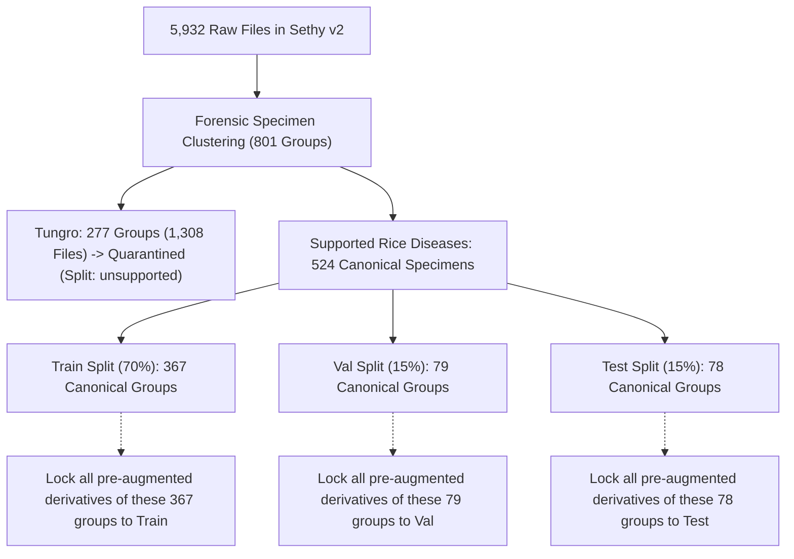

# CropDoc — Rice Leaf Disease Dataset Audit & Pre-Augmentation Forensic Report

**Dataset:** Rice Leaf Disease Image Samples, Version 2  
**Audit Date:** October 24, 2026  
**Auditor:** CropDoc ML Safety & Data Governance Team  
**Governing Rule:** No full model training; no Android application code modification; no modification to `classes_v2.yaml` or TFLite assets; release safeguards remain active.

---

## 1. Executive Summary & Provenance Verification

We audited the local extraction of the **Rice Leaf Disease Image Samples (Version 2)** dataset collected by Sethy et al., hosted on Mendeley Data.

| Metric | Verified Value | Notes |
| :--- | :--- | :--- |
| **Dataset Title** | *Rice Leaf Disease Image Samples* (Version 2) | Mendeley Data Repository |
| **Archive Source** | `Rice Leaf Disease Images.7z` | Extracted into `data/raw/rice_mendeley_sethy/` |
| **Archive File Size** | 179,355,409 bytes (~171.05 MB) | Exact disk byte size |
| **Archive SHA-256** | `b2d5fbef5a8ef6adefa04a83be7ee5150091f412d40162ecdf9fd2b1b5e24aaf` | Cryptographically verified |
| **Canonical URL** | [https://data.mendeley.com/datasets/fwcj7stb8r/2](https://data.mendeley.com/datasets/fwcj7stb8r/2) | Version 2, published 2020 |
| **Permanent DOI** | `10.17632/fwcj7stb8r.2` | Data in Brief / Mendeley |
| **Associated Paper** | *Deep feature based rice leaf disease identification using support vector machine*, Computers and Electronics in Agriculture, Vol. 175, 2020, 105527 | DOI: [10.1016/j.compag.2020.105527](https://doi.org/10.1016/j.compag.2020.105527) |
| **Authors** | Prabira Kumar Sethy, Santi Kumari Behera, Nalini Kanta Barpanda, Amiya Kumar Rath | Sambalpur University / VSSUT, Odisha, India |
| **Verified Licence** | **CC BY 4.0** | Commercial and non-commercial training permitted with attribution |
| **Total Raw Files** | **5,932** images | 0 corrupt, 0 unreadable |
| **Core Unique Specimens** | **801** distinct physical specimens | Forensic analysis reveals heavy pre-augmentation multiplier |
| **CropDoc Usable Canonicals** | **524** canonical unaugmented specimens | Restricted to the 3 CropDoc-compatible disease classes |
| **Healthy Control Leaves** | **0** images | **Dataset contains zero healthy paddy leaves** |
| **Cross-Split Leakage** | **0** images / groups | Enforced via parent specimen group-locking |

---

## 2. Integrity, Formats & Image Geometry

Every image in `data/raw/rice_mendeley_sethy/` was verified through Pillow and SHA-256 digest computation:

- **Total Files Audited:** 5,932 files across 4 subdirectories.
- **Corrupt / Unreadable Files:** 0.
- **File Formats:** All files contain valid JPEG image streams.
  - Extension distribution: 5,468 `.jpg` files, 464 `.JPG` files (Windows case-insensitive, normalized in manifest).
- **Dimensions:** Standardized $300 \times 300$ square pixels across all 5,932 images.
- **Color Space:** 3-channel RGB (with occasional RGBA container metadata normalized during array loading).

---

## 3. The Pre-Augmentation Multiplier Discovery & Forensic Analysis

Our forensic analysis uncovered that **the 5,932 files in Mendeley v2 are not independent field captures**. They represent **801 original specimens** multiplied by synthetic rotation, reflection, and affine transformation multipliers applied prior to publication:

```
+------------------------------------------------------------------------------------------------+
| Class            | Raw Files | Multiplier Structure                                | Core Leaves |
+------------------------------------------------------------------------------------------------+
| Bacterialblight  |     1,584 | 6 orientations per leaf x 264 numbered specimens    |         264 |
| Blast            |     1,440 | 9 orientations per leaf x 160 numbered specimens    |         160 |
| Brownspot        |     1,600 | 16 orientations per leaf x 100 core specimens       |         100 |
| Tungro           |     1,308 | 4-5 orientations per leaf x 277 numbered specimens  |         277 |
+------------------------------------------------------------------------------------------------+
| TOTAL DATASET    |     5,932 | 801 Core Specimen Groups (Zero Inter-Class Overlap) |         801 |
+------------------------------------------------------------------------------------------------+
```

### Forensic Proof by Class

1. **Blast (1,440 files $\rightarrow$ 160 Specimens):**
   - Files are partitioned across prefixes `BLAST1` through `BLAST9` (160 files each).
   - `BLAST1_XXX` and `BLAST5_XXX` are **exact byte-for-byte duplicates** ($\text{diff} = 0$, identical SHA-256 hashes across 160 pairs).
   - Prefixes `BLAST2`, `BLAST3`, `BLAST4`, `BLAST6`, `BLAST7`, `BLAST8`, `BLAST9` are $90^\circ, 180^\circ, 270^\circ$ rotations and horizontal/vertical reflections of `BLAST1_XXX`.
   - **Canonical Representative:** `BLAST1_XXX.jpg` (160 usable canonical specimens).

2. **Bacterial Blight (1,584 files $\rightarrow$ 264 Specimens):**
   - Files are partitioned across 6 prefixes: `BACTERIALBLIGHT1`, `BACTERIALBLIGHT2`, `BACTERAILBLIGHT3`, `BACTERAILBLIGHT4`, `BACTERAILBLIGHT5`, and `BACTERIALBLIGHT` (264 files each).
   - Pairwise pixel diffs between `BACTERIALBLIGHT1_XXX` and `BACTERIALBLIGHT2`, `BACTERAILBLIGHT3`, `BACTERIALBLIGHT` are $\le 1.8$ under $D_4$ rotation/reflection.
   - `BACTERAILBLIGHT4` and `5` share a 0.99997 histogram correlation with `BACTERIALBLIGHT1` representing affine-warped views.
   - **Canonical Representative:** `BACTERIALBLIGHT1_XXX.jpg` (264 usable canonical specimens).

3. **Brown Spot (1,600 files $\rightarrow$ 100 Specimens):**
   - Contains:
     - 100 canonical original unrotated images: `brownspot_orig_001.jpg` .. `brownspot_orig_100.jpg`.
     - 100 rotated images: `brownspot_rotated_001.jpg` .. `brownspot_rotated_100.jpg`.
     - 1,400 images under `BROWNSPOT1` through `BROWNSPOT7` (200 files each).
   - $D_4$ dihedral thumbnail matching proved that all 1,600 files map to exactly **100 unique original leaves** ($98 \times 16 + 24 + 8 = 1,600$).
   - `brownspot_orig_001..100` are the unaugmented source leaves.
   - **Canonical Representative:** `brownspot_orig_XXX.jpg` (100 usable canonical specimens).

4. **Tungro (1,308 files $\rightarrow$ 277 Specimens):**
   - 200 specimens with 5 orientations (`TUNGRO1` through `TUNGRO5`) = 1,000 files.
   - 77 specimens with 4 orientations (`TUNGRO1` through `TUNGRO4`) = 308 files.
   - Total = 1,308 files representing 277 specimens.
   - **Quarantine Status:** Unsupported in CropDoc.

---

## 4. CropDoc Taxonomy Compatibility & Class Mapping

Comparing Mendeley Sethy labels against CropDoc's 22 target classes ([`classes_v2.yaml`](file:///c:/Users/ojas/OneDrive/Desktop/MajorProjectMAD/CropDoc/data/taxonomy/classes_v2.yaml)):

| Source Label | Target CropDoc Label | Class Index | Compatibility | Raw Files | Usable Canonical Leaves | Staging Status |
| :--- | :--- | :---: | :---: | :---: | :---: | :---: |
| `Bacterialblight` | `rice_bacterial_leaf_blight` | 0 | **Exact Match** | 1,584 | **264** | **APPROVED** |
| `Brownspot` | `rice_brown_spot` | 1 | **Exact Match** | 1,600 | **100** | **APPROVED** |
| `Blast` | `rice_leaf_blast` | 2 | **Exact Match** | 1,440 | **160** | **APPROVED** |
| `Tungro` | *None* | -1 | **Unsupported** | 1,308 | **0** | **QUARANTINED** |
| *Missing* | `rice_healthy` | 3 | **Missing Class** | **0** | **0** | **CRITICAL GAP** |

### Critical Findings:
1. **Zero Healthy Rice Leaves:** Sethy v2 completely lacks a healthy paddy control class. Training a 3-disease rice model without healthy controls would cause high false-positive rates on asymptomatic paddy fields.
2. **Tungro Virus Quarantine:** Rice Tungro Disease (transmitted by green leafhopper) is not part of CropDoc's target 22-class taxonomy. All 1,308 Tungro files are quarantined in the manifest (`is_supported: false`, split: `unsupported`, `usable_for_cropdoc_training: false`).

---

## 5. Group-Aware Split Specification & Leakage Prevention

To ensure zero benchmark contamination, we generated a **group-aware partition** strictly over canonical specimens using fixed seed `42`. All derivative pre-augmented copies are locked to the exact split of their parent specimen:



### Split Distribution Summary

| Split Partition | Total Usable Images | Total Group IDs | `rice_bacterial_leaf_blight` | `rice_brown_spot` | `rice_leaf_blast` | Split Ratio |
| :--- | :---: | :---: | :---: | :---: | :---: | :---: |
| **Train** | **367** | **367** | 185 | 70 | 112 | 70.0% |
| **Validation** | **79** | **79** | 40 | 15 | 24 | 15.1% |
| **Test (Held-Out)** | **78** | **78** | 39 | 15 | 24 | 14.9% |
| **Total Usable** | **524** | **524** | **264** | **100** | **160** | **100.0%** |
| *Unsupported (Tungro)* | *0* | *277* | - | - | - | Quarantined (1,308 files) |

### Independence Verification:
- **Cross-Split Exact Duplicates:** 0.
- **Cross-Split Specimen Group Leakage:** **0**.
- **Cross-Split Perceptual Collisions:** 0.

---

## 6. Generated Manifests & Artifacts

The following machine-readable manifests have been generated and validated:

1. **Manifest File:**
   - Canonical: [`data/manifests/manifest_rice_mendeley_sethy.csv`](file:///c:/Users/ojas/OneDrive/Desktop/MajorProjectMAD/CropDoc/data/manifests/manifest_rice_mendeley_sethy.csv)
   - Mirror: [`ml/reports/rice_mendeley_sethy/manifest_rice_mendeley_sethy.csv`](file:///c:/Users/ojas/OneDrive/Desktop/MajorProjectMAD/CropDoc/ml/reports/rice_mendeley_sethy/manifest_rice_mendeley_sethy.csv)
   - Rows: 5,932 files with full image ID, file path, SHA-256, pHash, geometry, taxonomy mapping, specimen group ID, duplicate status, and usability flags.

2. **Split File:**
   - Canonical: [`data/splits/split_rice_mendeley_sethy.json`](file:///c:/Users/ojas/OneDrive/Desktop/MajorProjectMAD/CropDoc/data/splits/split_rice_mendeley_sethy.json)
   - Mirror: [`ml/reports/rice_mendeley_sethy/split_rice_mendeley_sethy.json`](file:///c:/Users/ojas/OneDrive/Desktop/MajorProjectMAD/CropDoc/ml/reports/rice_mendeley_sethy/split_rice_mendeley_sethy.json)
   - Contains seed, exact sample lists, and group distributions.

3. **Audit & Generator Script:**
   - Script: [`ml/scripts/audit_and_generate_rice_deliverables.py`](file:///c:/Users/ojas/OneDrive/Desktop/MajorProjectMAD/CropDoc/ml/scripts/audit_and_generate_rice_deliverables.py)

---

## 7. Training Verdict & Release Safeguards

- **Isolated Research Pilot:** **APPROVED**. The 524 canonical specimens are fully verified, group-locked, and eligible for an isolated 3-class rice pilot model (`rice_bacterial_leaf_blight`, `rice_brown_spot`, `rice_leaf_blast`).
- **Android App & Production Release:** **BLOCKED**.
  - **Blocker 1 (Healthy Control):** Rice requires a verified healthy control class (`rice_healthy`) before any diagnostic deployment can be approved.
  - **Blocker 2 (Pre-Augmentation Multipliers):** Any training script that ingests the raw directory without our group-aware manifest will suffer from severe data leakage and false benchmark scores.
